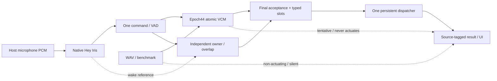
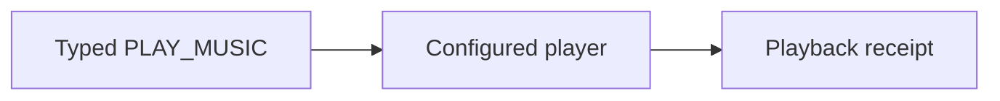
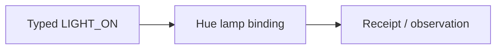
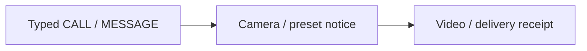

# BMO

**Local voice commands in 175,653 parameters.**

BMO maps mono 16 kHz speech directly to typed commands, without ASR or cloud recognition. One shared encoder covers **18 intent families, 34 complete commands and 102 canonical wordings**.

The chosen model is **baseline A: `shared-demo-slots-v1 / heads_s53`, epoch 38**. It scored **132/167 human DEV commands versus 130/167** for the similarly sized flat control; both scored 400/408 on supported demo DEV commands. It is not production-qualified; actions remain disabled.

[Download the model](submission/models/shared-demo-a/model.onnx) · [Exact hashes](submission/shared-demo-a/snapshot.json) · [All wordings](submission/shared-demo-a/commands.csv) · [Training and reproduction](docs/REPRODUCIBILITY-shared-demo-a.md) · [Actual reproduction results](docs/EXPERIMENT-shared-demo-a-reproduction-v1.md)

[Interactive documentation](https://justinruaya123.github.io/smart-speaker/) covers architecture, datasets, training and benchmarks. [Pages instructions](docs/BMO-PAGES.md).

## What the VCM recognizes

| Family | Finite acoustic coverage |
|---|---|
| Music and media | Play, pause, stop, next; volume up/down or 0/50/100% |
| Lights | Global on/off; brightness 0/50/100%; red, green or blue |
| Time | Current time; timers 10/30/60 seconds; alarms 06:00/12:30/21:45, Asia/Manila |
| Temperature | 18/22/26 degrees Celsius |
| Reminders | Drink water, study, exercise; list reminders |
| Other requests | Weather, fixed home-camera CALL target and preset MESSAGE request |

SpeakerUI supplies the configured actions; CALL is camera-only. Arbitrary names, dictation and numeric combinations are unsupported. **Kitchen/Ceiling names are not in A's catalog.** Legacy brightness 20/60 and alarm 08:00/21:00 remain outside this catalog.

## Model and training recipe

| Item | Retained A recipe |
|---|---|
| Frontend | 40-bin causal log-mel; normalization fitted only on 1,889 human TRAIN recordings |
| Encoder | Width-128 causal CNN; temporal stride 2; four kernel-7 blocks with dilations 1/2/4/8; masked mean/max pooling |
| Heads | 29 action outputs + 4 percentage outputs + 4 alarm-time outputs, including missing/UNKNOWN categories |
| Full fit | Random initialization, seed 53; 6 human-foundation + 42 mixed epochs; 96 updates/epoch, batch 32; **4,608 optimizer updates** |
| Optimizer | AdamW, LR 0.002 with mixed cosine decay to 0.00005, weight decay 0.01; CUDA BF16 |
| Loss | Action cross-entropy + 0.5 percentage loss + 0.5 alarm-time loss |
| Decision | Action-authoritative argmax; missing required slots reject; no slot rescue or calibrated confidence threshold |

TRAIN contains **25,958 recordings: 1,889 human and 24,069 synthetic**. Sampling balances sources rather than following raw file proportions. The added demo voices use six TRAIN TTS identities across US, British, Australian, Singaporean and Philippine provider locales, with two separate DEV voices and **two reserved TEST voices**. Inherited human/synthetic sources remain part of training. Provider identities do not certify independent human speakers or accent fidelity.

DEV selects weights before TEST. A's DEV win is not a guarantee of per-intent nonregression. The later PH/named-device child did not replace it. [Frozen protocol](submission/shared-demo-a/protocol.json) · [Study and comparisons](docs/EXPERIMENT-shared-demo-slots-v1.md).

## Measured command correctness

A result is correct only when the entire intent and every required slot match.

| Population | Complete commands correct | Interpretation |
|---|---:|---|
| Exact synthetic TEST phrases | **203/204 (99.51%)** | 102 wordings, two reserved TEST voices |
| Same phrases with authored added context | **98/204 (48.04%)** | Extra spoken context remains a major weakness |
| Supported exposed-human regression | **71/77 (92.21%)** | Previously evaluated human recordings, not fresh blind qualification |
| Retained-human DEV | **132/167 (79.04%)** | Development evidence used for selection |

The exposed-human task-negative false accepts remain **5/19**. Small perfect TTS cells and high softmax scores do not establish live-speaker reliability. A does not literally filter arbitrary unknown words. Fresh human microphone, wake/owner and physical Raspberry Pi acoustic acceptance remain unmeasured. [Frozen metrics](submission/shared-demo-a/metrics.json) · [Per-verbatim results](submission/shared-demo-a/per-verbatim.csv) · [Full error accounting](docs/EXPERIMENT-shared-demo-a-reproduction-v1.md#same-outcomes-including-limitations).

## Pi 5 recorded replay

**4.76/9.37 ms p50/p95**, **84.55 MiB process-RSS** (A/MNN CPU, two threads). Historical **155/194 (79.90%)**; shared-catalog **155/167 (92.81%)**. Separate 196-clip holdout; 27 out-of-catalog references, two ambiguous exclusions. Repeat 2/2; three timing passes, first-pass scoring. Both repeats agree. Processing-only, not live accuracy/qualification. [Scores/scope](https://justinruaya123.github.io/smart-speaker/#dataset) · [Both-run receipt](docs/site/bmo/data/pi5-replay.json).


## Reproduce A or run the application

The measured fresh-main reproduction used CPython **3.13.14**, Torch 2.10.0+cu128 and an RTX 3080 with CUDA BF16. It completed all 48 epochs from random initialization, matched the selected tensors and exported **byte-identical ONNX**, with all 642 original evaluation decisions unchanged. Native checkpoint serialization differs; CPU/cross-OS equality is not claimed.

After cloning this repository, use the pinned scientific environment and a new output directory:

```sh
uv venv --python 3.13.14 .venv
uv pip install --python .venv/Scripts/python.exe --index-strategy unsafe-best-match -r submission/shared-demo-a/requirements-training.txt
.venv/Scripts/python.exe -B scripts/shared_demo_a.py all --output .cache/baseline-a-reproduction-01
```

These Windows commands perform real fitting, not just weight loading. The [runbook](docs/REPRODUCIBILITY-shared-demo-a.md) gives POSIX interpreter paths, backend requirements, immutable input acquisition and failure gates. Plain `python reproduce.py` still verifies historical epoch44; it does **not** select A or train it.

**This repository owns models, training, data provenance and export. [SpeakerUI](https://github.com/justinruaya123/SpeakerUI) owns inference, the Ambient UI, wake/VAD/owner orchestration and integrations.** Install and run the application from its own checkout:

```sh
git clone https://github.com/justinruaya123/SpeakerUI.git
cd SpeakerUI
python -m scripts.model_assets
python inference.py --check
python inference.py --mode ui --no-audio
```

SpeakerUI pins A's producer assets and verifies their hashes. Its `benchmark.py` remains an explicit historical epoch44 comparison, not an A qualification result. A's parameter count excludes separate wake/VAD/owner companions. Optional services need their own configuration; local recognition is not a claim that setup or every provider is offline.

Data and weights retain source-specific research, consent and redistribution restrictions; see the [treated dataset and citations](https://huggingface.co/datasets/justinruaya123/ai231-smart-speaker/tree/main/shared-demo-a-v1). No blanket open license applies. Historical model cards and the appendix describe older models, not A.

<details>
<summary>Historical epoch44 reference (different model, catalog and benchmarks)</summary>

# Iris

**Say Hey Iris. Give a supported command. Iris recognizes it locally and shows what happened.**

A finite voice-command model: **258,912 parameters · original epoch 44 · FP32 · 31 commands + UNKNOWN**. Recognition is local; optional services supply actions and external data. No transcript, ASR or LLM runs in the product. **Wake smoke gate FAILED; no replacement was promoted. This is an unqualified research build, not a working-acoustic-release claim.** Pi and fresh human live-microphone reliability remain unmeasured.

[Two-minute slides and script](docs/PRESENTATION-optionb-tiny-2minute.md) · [Historical animated presentation](docs/site/reference.html) · [Getting started](docs/IRIS-GETTING-STARTED.md) · [Model card](docs/MODEL-CARD-iris-epoch44.md) · [Verified JSON](docs/site/assets/iris.json)

## Repositories and quickstart

**smart-speaker owns training, model verification, provenance and model distribution.** [SpeakerUI](https://github.com/justinruaya123/SpeakerUI) owns the complete application: inference, Ambient display, gateway, wake/owner sessions, integrations, runtime benchmarks and device deployment. Neither checkout imports the other or shares its environment.

Verify the original model without fitting or installing the application:

```sh
git clone https://github.com/justinruaya123/smart-speaker.git
cd smart-speaker
python -B -m scripts.optionb_epoch44 verify
python -B reproduce.py
```

Both commands verify the original frozen bytes; they do **not** train. Explicit fitting and permitted evaluation-data preparation use the [pinned original-source workflow](docs/REPRODUCIBILITY-optionb-epoch44.md). Existing failed exact-CPU reconstruction and acoustic gates remain failures. Training-time calibration/export scoring remains here; standalone inference and hardware benchmarks do not.

Run the application from its own repository (GitHub access to SpeakerUI is required):

```sh
git clone https://github.com/justinruaya123/SpeakerUI.git
cd SpeakerUI
python -m scripts.model_assets
python inference.py --check
python inference.py --mode ui --no-audio
python -m scripts.model_assets --evaluation
python benchmark.py --output .cache/benchmark-run-01
```

SpeakerUI pins model/companion bytes to an exact producer Git revision, verifies sizes/SHA-256, and prepares its own locked local environments. No sibling smart-speaker checkout is required. Model-only archives exclude the application, runtime processes, private state, audio corpora and training checkpoints. [Migration and producer operations](docs/REPOSITORY-BOUNDARY.md) · [Application operations](https://github.com/justinruaya123/SpeakerUI/blob/main/docs/OPERATIONS.md).

The application default benchmark remains the original exposed **196-recording holdout**, not a new blind qualification set. Software checks, desktop replay, physical Pi performance, fresh human wake/command evidence and actual provider outcomes remain distinct. No model/policy/wake upgrade or action enablement is part of this repository split.

## Pipeline



One wake owns one command. The acoustic decision, owner veto and action outcome are separate. One host-owned playback path provides wake acknowledgment, intent beep and completion cue only after the final result. Unknown provider outcomes remain unknown and are not retried automatically.

OpenWakeWord belongs to this **inference wake stage**, not the command classifier or a separate product. The [experimental application adapter](https://github.com/justinruaya123/SpeakerUI/blob/main/scripts/runtime/iris_openwakeword.py) and [source/evaluation record](experiments/iris-openwakeword-publication-v1/findings.json) retain their respective application/research owners. The application adapter lives in **SpeakerUI**; immutable evaluation evidence remains here. That candidate failed its acoustic gates and was not installed, promoted or wired into the live worker; the existing native wake default remains unchanged. Publishing source is not acoustic qualification.

## Model

```mermaid
flowchart LR
  PCM[Mono16kHz] --> MEL[40-bin causal log-mel]
  MEL --> NORM[Human TRAIN-only normalization]
  NORM --> STRIDE[Feature stride2]
  STRIDE --> STEM[Causal stem / kernel5]
  STEM --> BLOCKS[Four width160 residual blocks]
  BLOCKS --> POOL[Valid-length masked mean + max]
  POOL --> HEAD[320 features / one32-way head]
  HEAD --> POLICY[Non-UNKNOWN / posterior at least .50 / margin at least .10]
  POLICY --> CMD[Complete intent + fixed slots]
```



Two depthwise/pointwise stages per block; kernel 7, dilation 1/2/4/8, LayerNorm and SiLU. Class 0 is UNKNOWN. **18 intent families and 93 wording definitions are not 93 transcript outputs.** Graph:1,082,940 bytes; five-file bundle:1,088,682 bytes. Native wake82,114 parameters, owner129,985 runtime parameters and separate 2.33 MB VAD graph are **additional** costs. [Exact hashes, architecture and limits](docs/MODEL-CARD-iris-epoch44.md).

## Ten use cases

All31 positive classes are assigned exactly once by the [generator/tests](scripts/iris_publication_data.py). The [historical deck](docs/site/reference.html#uses) shows ten selectors in one pipeline/JSON/output frame. These are **supported wording definitions and illustrated outputs**, not observed recognition/provider results.

| ID | Category | Output/source boundary |
|---|---|---|
| UC-01 | Music | Synthetic playback / Playing · demonstration only |
| UC-02 | Questions | Synthetic weather / Weather unavailable |
| UC-03 | Lights | Synthetic light / Lamp on · simulated |
| UC-04 | Dim / color | Synthetic light / 20% · red · simulated |
| UC-05 | Timer | Local job example / 0:10 |
| UC-06 | Alarm | Local job example / 06:00 · Asia/Manila |
| UC-07 | Temperature | Synthetic target / 22°C target |
| UC-08 | Media | Synthetic playback / Paused · simulated |
| UC-09 | Reminders | Local job example / Study |
| UC-10 | Calls / messages | Synthetic camera / notice / Home camera · video only |

<details>
<summary>Ten mini diagrams, exact JSON and honest example outputs</summary>

**UC-01 · Music — “Play music”**



`{"intent":"PLAY_MUSIC","slots":{}}` → **Synthetic playback: Playing · demonstration only.** No audio is playing. A configured provider must supply its actual result.

**UC-02 · Questions — “Weather” / “Time”**


`{"intent":"WEATHER","slots":{}}`; `{"intent":"TIME","slots":{}}` → **Synthetic weather: Weather unavailable.** No current observation. OpenWeather → honestly dated cache → labeled synthetic fallback. Time uses the local Manila clock.

**UC-03 · Lights — “Turn on the lights”**



`{"intent":"LIGHT_ON","slots":{"light_id":"light.all"}}` → **Synthetic light: Lamp on · simulated.** Target light.hue_color_lamp_1. No device changed; a provider acknowledgment is not an observed state.

**UC-04 · Dim / color — “Brightness 20 percent” / “Change color to Red”**


`{"intent":"BRIGHTNESS","slots":{"light_id":"light.all","percent":20}}`; `{"intent":"COLOR","slots":{"light_id":"light.all","color":"red"}}` → **Synthetic light: 20% · red · simulated.** Finite brightness 20 / 60 / 100%; colors red / blue / green. No device changed.

**UC-05 · Timer — “Timer 10 seconds”**


`{"intent":"TIMER","slots":{"duration_seconds":10}}` → **Local job example: 0:10.** Example of a saved ten-second countdown. This static deck starts no job; the application persists jobs and due alerts.

**UC-06 · Alarm — “Alarm 6:00 AM”**


`{"intent":"ALARM","slots":{"time":"06:00","timezone":"Asia/Manila"}}` → **Local job example: 06:00 · Asia/Manila.** Next matching Manila deadline, not a fixed UTC offset guessed by the deck. No alarm is scheduled here.

**UC-07 · Temperature — “Temperature 22 degrees”**


`{"intent":"TEMPERATURE","slots":{"degrees":22,"unit":"C"}}` → **Synthetic target: 22°C target.** Observed home sensor: unavailable. No climate service is called. Target and real measured temperature stay separate.

**UC-08 · Media — “Pause” / “Next song” / “Volume up”**


`{"intent":"PAUSE","slots":{}}`; `{"intent":"NEXT","slots":{}}`; `{"intent":"VOLUME","slots":{"operation":"up"}}` → **Synthetic playback: Paused · simulated.** Provider semantics apply: Spotify STOP is pause, not a claimed device stop. No playback changed here.

**UC-09 · Reminders — “Remind me to Study” / “List my reminders”**


`{"intent":"CREATE_REMINDER","slots":{"task_id":"task.study"}}`; `{"intent":"LIST_REMINDERS","slots":{}}` → **Local job example: Study.** Finite tasks: drink water / study / exercise. The application persists the list; this example writes nothing.

**UC-10 · Calls / messages — “Call” / “Message”**



`{"intent":"CALL","slots":{"contact_id":"contact.home"}}`; `{"intent":"MESSAGE","slots":{}}` → **Synthetic camera / notice: Home camera · video only.** Target camera.dining_area_main_camera_tc70_mainstream. No telephone call, stream or notification is started by this deck.

</details>

Voice values stay finite: timers10/30/60s; alarms06:00/08:00/21:00 Manila; temperatures18/22/26°C; brightness20/60/100%; red/blue/green; drink water/study/exercise. Broader touch/configuration controls do not create acoustic recognition.

## Data, training and testing

| Split | Human | Synthetic |
|---|---:|---:|
| TRAIN |1,889|21,426|
| DEV |256|995|
| Calibration |210|0|
| TEST |1,050|3,368|
| HOLDOUT |96|100|

TRAIN uses 1,889 human +5,982 synthetic primary rows and 15,444 supplemental synthetic rows; [exact revisions/terms](docs/IRIS-CITATIONS.md). Only human TRAIN fits normalization. Original recipe: seed 53, CPU/four Torch threads,6 human +42 mixed epochs,96 batches/epoch,32 samples/batch, AdamW,4,608 updates,2,987.91s fit. [Actual curve/summary](presentation/evidence/manifest.json).

| Reproducibility statement | Status |
|---|---|
| Exact original artifact verification/loading | PASS: `python -m scripts.optionb_epoch44 verify --load` |
| Original source/features | Hash-bound pinned-source reconstruction evidence |
| GPU-to-GPU repeatability | Two historical full fits matched; selected epoch 28 |
| Exact original CPU epoch 44 retraining | **Not verified; comparison failed. No success lock is invented.** |

The [original-source runbook](docs/REPRODUCIBILITY-optionb-epoch44.md) preserves failures; benchmarking is a separate lane. No model/policy is retuned for these exposed cohorts:

| Cohort | Correct accepts / positives | Wrong accepts, including negatives | Negative false accepts | Ambiguous, unscored |
|---|---:|---:|---:|---:|
| HOLDOUT |72/80|3|1/14|2|
| TEST |393/609|59|24/256|185|

Exact metadata-wording subsets:58/62 and 173/232, not full 93-wording human coverage;21 definitions lack exact human references. Fresh human wake/command, ownership and Pi qualification remain unmeasured. **New synthetic wake study failed:** existing native wake detected 1/32 positives with 0/68 false wakes; the separately trained same-size companion detected 21/32 with 2/68 false wakes. **Neither passed; no replacement was promoted.** [Actual wake receipt](presentation/evidence/wake-smoke-status.json). Historical17/32 calibration is a different cohort, not the new gate. Static-site/software checks cannot turn this into an acoustic release pass.

## Desktop benchmark

| Actual run | p50 / p95 recognition latency |
|---|---:|
| Historical original PC |4.82 /8.41 ms|
| Historical later repeat v2 |5.36 /8.69 ms|
| 2026-10-24 reference driver, **under publication load** |9.34 /15.34 ms|
| Current adapter, product lock (**not quiesced**) | 5.39 / 10.57 ms |
| Raspberry Pi |**Not measured — `pi:null`**|

Current environment: NumPy 2.5.3 / ONNX Runtime 1.30.0; peak whole-process RSS **84.68 MiB**, not model-only RAM. [Actual audited receipt](presentation/evidence/desktop-product.json): all 1,146 WAV/decoded-PCM identities and 3,438 complete typed outputs independently matched frozen gold. Direct VCM only; wake/owner/UI/providers and speaking time excluded. This does not improve the failed wake gate.

The historical and original-reference runs use Intel Core i7-11700/Windows 11/Python 3.13.14, CPUExecutionProvider, one ONNX/frontend BLAS thread; all named runs use 1,146 original human recordings ×3 =3,438 calls. Repeats do not inflate accuracy denominators. Scope: PCM validation, frontend, normalization, ONNX and finite decision; **excludes** speech, decode, wake/VAD waiting, worker/gateway/UI, audio and providers. The new reference run is not quiesced, not the new adapter and not end-to-end latency. No unrelated256-DEV memory probe is called full-PC memory. [Receipts/hashes](docs/site/assets/iris.json).

## Limits and real versus synthetic

Only enabled final live microphone commands may actuate after guards. Tentative previews, WAVs, checks and benchmarks never do. Missing providers show **Synthetic — no device changed**, not a real acknowledgment. Unknown outcomes remain unknown. OpenWeather caches keep honest timestamps; thermostat targets are synthetic only, separate from observed sensors. Recognized lights bind to the Hue lamp; CALL opens the dining camera **video only**, not telephony.

No arbitrary names, songs, numbers, dictation or general search. Setup/providers are not an offline/privacy absolute. Data-specific research, non-commercial and consent restrictions remain; no blanket MIT license is claimed for weights/recordings.

## Development and rollback

[Render/source instructions](presentation/README.md) · [Citation audit](docs/IRIS-CITATIONS.md) · [Release log](docs/RELEASE-iris-publication-v1.md) · [Revert guide](docs/REVERT-iris-publication-v1.md). Historical [root model card](MODEL_CARD.md), [dataset directory](docs/DATASETS.md) and [experiment index](EXPERIMENTS.md) are preserved; their969k/2M results do not describe this VCM.

```sh
python -B scripts/iris_publication_data.py --check
python -B -m unittest scripts.test.test_iris_publication_data -v
python -B presentation/validate.py
```

## Citation

Cite the exact repository revision and frozen model hash. Primary dataset: **DOI[10.57967/hf/10723](https://doi.org/10.57967/hf/10723)**, revision `25111444af3adff7588d86ab27c304bb080895cf`. Supplemental:[`martinnavs/ai231-fil-supplemental-data`](https://huggingface.co/datasets/martinnavs/ai231-fil-supplemental-data/tree/230c8b8d58caf78e4bc90886d9c6fa77fe6024b8), revision `230c8b8d58caf78e4bc90886d9c6fa77fe6024b8`. Retain original-source attribution, consent and research-use restrictions; the [audit](docs/IRIS-CITATIONS.md) distinguishes actual membership from wider sources.

```bibtex
@software{iris_epoch44_2026,
  author = {{Iris project contributors}},
  title = {Iris: Original OptionB Epoch44 Finite-Command Smart Speaker},
  year = {2026},
  url = {https://github.com/justinruaya123/smart-speaker},
  version = {OptionBTinyVCM-1 epoch44},
  note = {258912 parameters; FP32; graph SHA256 c1cd773b92337fd2a453554b047fa555c692fb981b5975700a32260388d4b9ce; cite exact source revision used}
}
```

</details>
