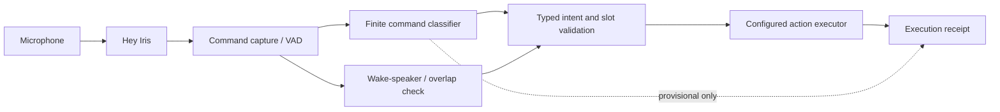
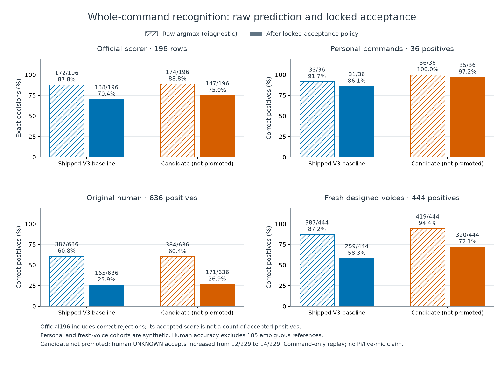
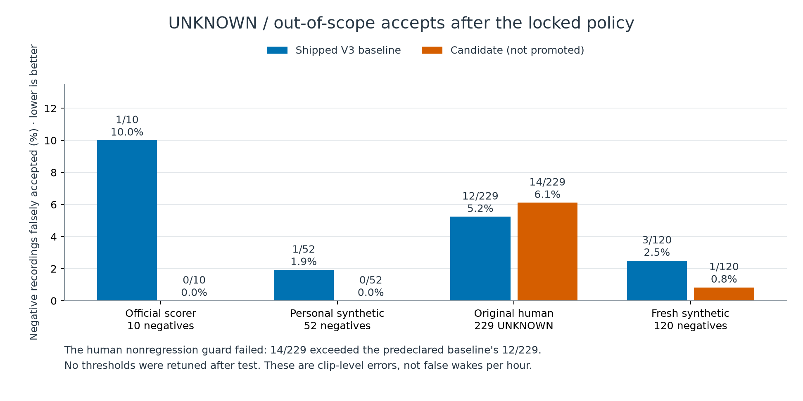
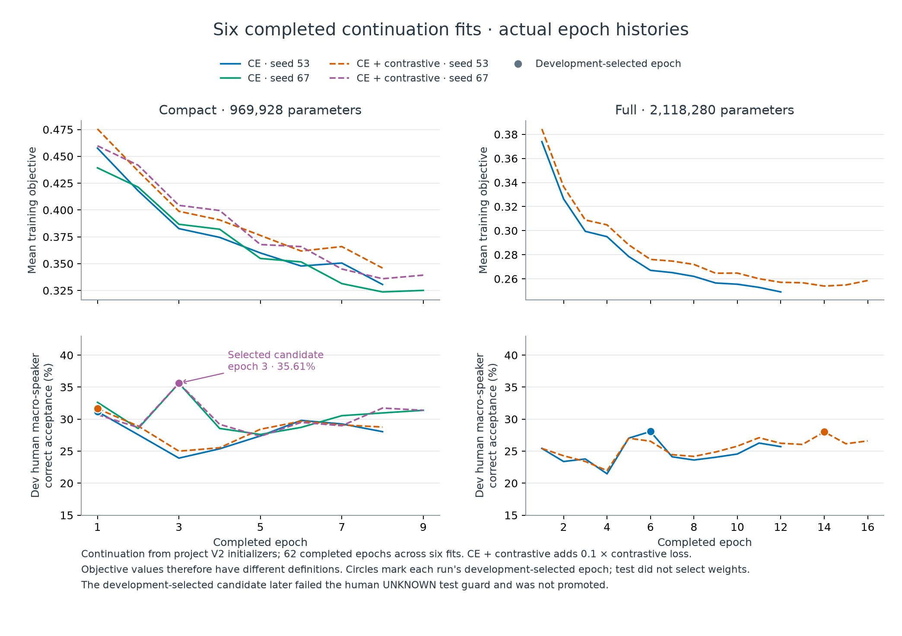
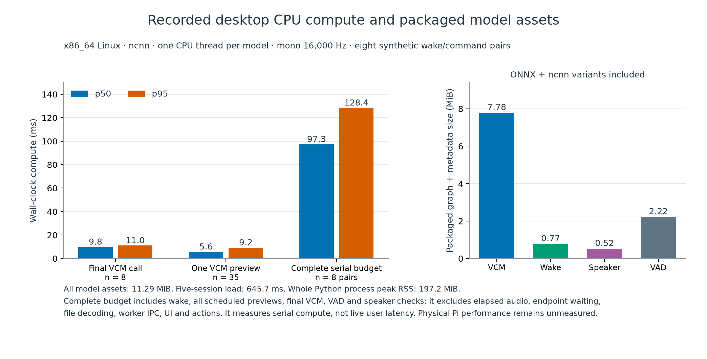

# Iris

An offline, finite-command smart speaker for Raspberry Pi 4/5. Say **Hey Iris**, then one supported command. A compact neural network predicts a complete command and its fixed slot values directly from audio. No transcription, LLM or remote recognition service runs in the product.

| Component | Release |
|---|---|
| Command model | 969,928 parameters, width 128, 328 frozen acoustic outputs, 3.97 MB ONNX |
| Wake | Own Hey Iris network, 82,114 parameters |
| Voice ownership | Separate 129,985-parameter encoder and overlap head; experimental |
| Runtime | ncnn CPU by default; explicit ONNX Runtime comparison |
| Product | Microphone capture, Svelte/Fastify UI, provisional guesses, validated actions and persistent jobs |
| Platform evidence | DGX/Linux software and recorded-audio checks; physical Pi qualification remains unmeasured |

[Model card](MODEL_CARD.md) · [Experiment evidence](EXPERIMENTS.md) · [Pi setup](docs/HANDOFF-iris-rpi-v1.md) · [Dataset provenance](docs/DATASETS.md) · [Reproduction report](docs/EXPERIMENT-iris-reproduction-v1.md)

## Reproduce on a DGX

GitHub **main** is the source of truth for the recipe, dependencies, code, inference models and reports. Hugging Face holds the dataset and **private** model/checkpoint artifacts. Use **Python 3.13** for the recorded training environment, Git and an authorized Hugging Face login or an existing `HF_TOKEN` environment variable. The separate Pi inference package supports Python 3.11–3.13. Do not put credentials in the repository. Original restricted recordings are fetched from their pinned upstream sources under their source terms.

```bash
git clone https://github.com/justinruaya123/smart-speaker.git
cd smart-speaker
CUDA_VISIBLE_DEVICES=0 python reproduce.py --device cuda --run-id dgx-reproduce
```

Replace `0` with one available GPU. CPU is the default: `python reproduce.py`. The entry point installs the pinned root environment and local UI toolchain, verifies source/data hashes, pulls the permitted dataset, performs **six actual VCM continuation fits**, calibrates and exports, evaluates the fixed benchmarks, checks Torch/ONNX/ncnn decisions, tests/builds the UI and packages the delivery. It does not download completed VCM runs to stand in for fitting. One GPU is used; other jobs are never stopped.

Each run has an isolated `.cache/iris-reproduction-v1/<run-id>/work` workspace with model/data caches independent of the development checkout. Immutable Hub downloads may be reused within the same clone; completed VCM fitting states are never reused for a new run. The original checkout and historical receipts stay unchanged. The outer `reproduction.json` records commands, source identity, timings, actual training selections, promotion gates, package location and comparison with the shipped inference bundle. Raw logs/checkpoints remain ignored. Choose a new run ID for another run. The bulk downloader uses the pinned Hub client’s supported HTTP transport to avoid per-file Xet token API exhaustion.

```bash
python reproduce.py --preflight-only        # install and verify/download inputs
python reproduce.py --skip-train            # selected-artifact evaluation/rebuild; no fitting
python reproduce.py --skip-train --publish  # verified artifacts to the private HF model
.venv/bin/python scripts/plot_benchmarks.py  # regenerate published figures from Git-owned evidence
```

The recipe continues our own pinned project initializers. Wake and owner fits are verified project companions. A candidate that fails promotion retains the predeclared baseline. This is not a claim of random-init, bit-identical reconstruction of the complete historical initializer chain; that chain has not been replayed. The lower-level `train.py` and final publication implementation in `scripts/iris_publish.py` are also in this repository. Publishing does not change GitHub or dataset visibility.

## Original epoch44 model (opt-in)

The original **258,912-parameter OptionB epoch44** model and recovery checkpoint are also published on main, separately from the default Iris release. Verify their exact bytes without training or third-party dependencies:

```sh
python -m scripts.optionb_epoch44 verify
```

Add `--load` with NumPy/ONNX Runtime installed to execute the original graph as an action-free software check. [Epoch44 reproduction commands and evidence](docs/REPRODUCIBILITY-optionb-epoch44.md) keep its pinned original source/environment and GPU-repeatability check separate from Iris. GPU training reproducibly selects epoch28, not the original CPU epoch44; those are explicitly different acceptance results. This does not change `reproduce.py`, the Iris model, runtime defaults or action permissions.

## Architecture and fixed commands



The VCM uses 40-bin log-mel features, a stride-two convolution, six contextual attention/depthwise-convolution blocks, masked mean pooling and one whole-command classifier. Each accepted acoustic ID maps to a fixed intent and fixed slots. There is **no dynamic slotting**, arbitrary-name enrollment or text decoder. The 31 baseline intent/slot outcomes and 93 wordings remain covered by the finite contract; personal commands add explicitly trained values. Configuration binds these recognized IDs to your entities and cannot teach a new spoken name.

| Area | Finite behavior |
|---|---|
| Music and media | Supported play/song/artist IDs, pause/stop/next/volume; configured HA player or explicit local playback |
| Time and weather | Local clock and supplied HA weather entity |
| Lights | On/off, supported brightness/color values and finite target IDs; supplied HA lights/groups |
| Temperature | Supported Celsius values to a configured climate entity |
| Timers and alarms | Recognized finite durations/times; persistent local scheduler |
| Reminders | Recognized finite tasks and reminder list |
| Calls and messages | Finite contacts/preset messages through supplied HA scripts |

A wake owns one subsequent command, then resets. Missing speaker evidence, another speaker or overlap rejects the session. It requires no persistent enrollment and does not separate overlapping voices. Original human wake-to-command qualification remains unmeasured.

## Training and measured results

The frozen comparison uses compact/full widths, CE versus CE plus 0.1 cross-speaker contrastive loss at temperature 0.1, seed 53, then both objectives at the development-selected width with seed 67. Fits use balanced human/synthetic, command/speaker batches, UNKNOWN speech, bounded masking and training-only gain. Development chooses weights and thresholds before tests.

| Command-only cohort | Shipped raw / policy | Candidate raw / policy |
|---|---:|---:|
| Official 196-row scorer | 172 / 138 | 174 / 147 |
| Personal, 36 synthetic positives | 33 / 31 | 36 / 35 |
| Original human, 636 positives | 387 / 165 | 384 / 171 |
| Fresh designed voices, 444 positives | 387 / 259 | 419 / 320 |

Official policy scores include correct rejections; the other policy columns count correctly accepted complete positive commands. Denominators and negative populations are distinct. The candidate was **not promoted**: original-human UNKNOWN accepts increased from 12/229 to 14/229, failing the frozen guard. The release retains the baseline. Synthetic voice prompts do not establish human demographic coverage. See the [model card](MODEL_CARD.md) for wrong accepts, intent/slot/speaker results and failed gates.









The [plot data](docs/assets/iris-benchmark-data.json) links exact receipts and hashes. Wake recall, duplicate/false wakes, speaker errors and full-pipeline failures are reported separately; command-only scores do not imply successful live ownership.

## Run inference and the UI

The complete selected inference bundle, including ONNX graphs, frozen catalog, normalization, policy and ncnn comparison files, is in [artifacts/iris](artifacts/iris). Its [integrity receipt](artifacts/iris/integrity.json) pins every payload. With the runtime environment installed:

```bash
.venv/bin/python -m scripts.runtime.speaker_worker --bundle artifacts/iris --check
.venv/bin/python -m scripts.runtime.speaker_worker --bundle artifacts/iris --wav /path/to/command.wav
```

WAV replay and benchmarks never execute actions. To audit a produced/downloaded ZIP from this checkout, use its published SHA-256 and a new evidence directory:

```bash
.venv/bin/python -m scripts.test.iris_package_replay \
  --package /path/to/iris-pi.zip --sha256 PUBLISHED_SHA256 \
  --output .cache/iris-reproduction-v1/offline-replay
```

This verifies the approved model hashes, extracts the package, installs a Python network-denial audit hook before runtime import and compares three replays under each engine. It checks PCM, raw decisions and typed outputs, preserves failures and never executes actions. It measures the current host, so DGX results are not Pi measurements.

For the full UI, extract the verified Pi ZIP produced by reproduction (or download it from the private model repository), then follow the [runbook](docs/HANDOFF-iris-rpi-v1.md). `python3 start.py --list-mics` selects the actual device; `python3 start.py --mode serve --mic INDEX --benchmarks skip` starts the product.

The main screen shows microphone/listening status, tentative intent/slots, final recognition and execution receipts. Tentative guesses are provisional and never execute. Only final accepted, speaker-checked, validated commands execute. Supply your HA entity/script bindings; missing mappings return **unconfigured**, without substituting another target. Receipts distinguish provider acceptance from observed state; unknown outcomes are not automatically retried. Timers, alarms, finite reminders and execution identifiers persist atomically across restarts.

## Evidence and limits

The unchanged benchmark scorer is fetched from a pinned upstream GitHub commit and verified by SHA-256; its license is recorded as unknown rather than assumed to be our code. Restricted recordings are not included in Git or newly uploaded. Third-party component and dataset terms are documented with [source receipts](docs/DATASETS.md).

Fresh human microphone/ownership tests, physical Pi latency/RAM/thermals and observed real device actions remain assigned operator acceptance steps. Desktop replay, software tests and a packaged ZIP do not establish those results.
