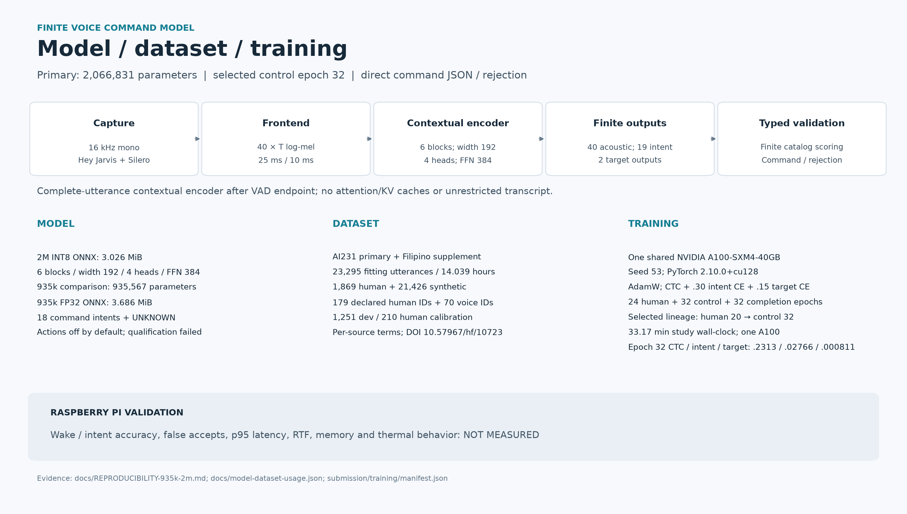
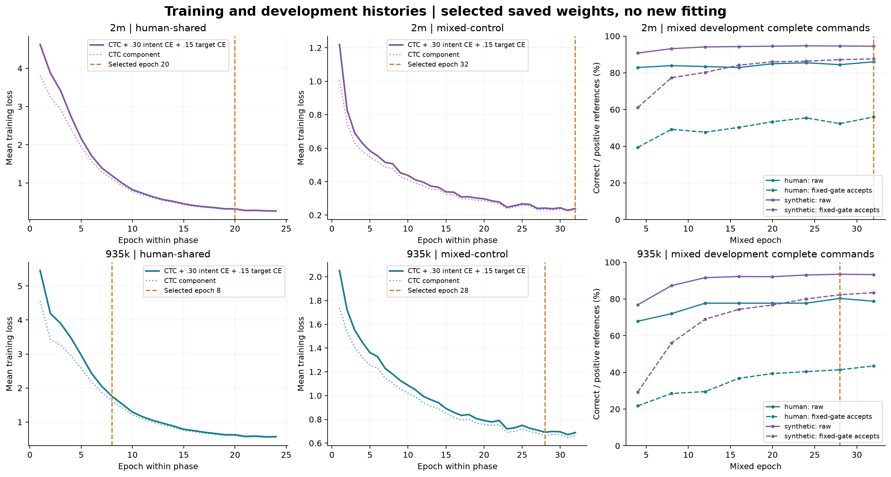

<!-- final-submission:start -->
# Final submission: 2M direct VCM

The primary model is **2,066,831 parameters, control mixed epoch 32** (`speaker-final-refinement-v1`); the 935,567-parameter pipeline-repair model is retained as comparison evidence. It encodes a complete utterance after the VAD endpoint and returns finite typed commands or rejection. The final submission uses ONNX Runtime CPU, one thread, pretrained Hey Jarvis/Silero activation and no transcription or cloud inference.

Use the [`codex/final-submission` branch](https://github.com/justinruaya123/smart-speaker/tree/codex/final-submission) for these entry points. For a fresh checkout: `git clone --branch codex/final-submission --single-branch https://github.com/justinruaya123/smart-speaker.git`.

```sh
python reproduce.py --seed 53 --yes --no-benchmark  # reconstruct pinned data and fit in a new workspace
python benchmark.py   # choose silent PC replay or SSH Pi replay
python inference.py   # choose CLI or prebuilt UI; input/output devices are prompted
```

See the [reproduction guide](docs/REPRODUCIBILITY-935k-2m.md), [dataset membership and terms](docs/DATASETS.md), [citations](docs/DATASET-CITATIONS.md), and [benchmark handoff](docs/BENCHMARK-HANDOFF.md). The [selected recovery checkpoint](submission/checkpoints/full-selected.pt) and [verbatim metric histories](submission/training/manifest.json) are retained separately from inference distribution. Use `--model-choice compact` to reproduce the comparison model explicitly.

**Reproduction checked on this host:** seed 53, 5,376 optimizer updates, 14.06 minutes fitting/development on one NVIDIA A100-SXM4-40GB. Weight tensors bitwise equal: **True**; maximum difference 0; exported ONNX SHA-256 matches the submission. Human project test: raw 516/636, correct demo accepts 274/636. Regenerated-model PC p50/p95 103.87/221.75 ms; peak worker RSS 84.21 MiB. The original cached fitting/development frontend and single-thread evaluation frontend are explicitly pinned; the initial rounding-drift evaluation is preserved, with no weight or threshold changes. The fit used a separate source/output folder and the root interpreter; fresh locked uv setup was verified separately. [Machine comparison](submission/reproduction-full/verification.json), [new training curves](submission/reproduction-full/figures/training-curves.png), [reproduction slide card](submission/reproduction-full/figures/model-dataset-training-card.png).

For the GUI, copy `SpeakerUI/.env.example` to private root `.env` and configure existing HA/Spotify credentials and flags. The default allowlist is `light.hue_color_lamp_1,light.dining_light,camera.dining_area_main_camera_tc70_mainstream`. Spotify voice scope is generic **play music** on its active/configured Connect device. Device controls require explicit `ACTIONS_ENABLED=true`; CLI, reproduction and benchmarks remain action-free. Map finite light labels under `[bindings.lights]` in private root `config.toml` for spoken light actions. [GUI configuration](SpeakerUI/README.md) describes setup; credentials are excluded from Git and ZIPs.



| Model | Fitting rows / hours | Human + synthetic | Selected human → mixed epoch | Study fit/dev wall-clock | Selected CTC / intent CE / target CE |
| --- | ---: | ---: | ---: | ---: | --- |
| 2m | 23,295 / 14.038888 h | 1,869 + 21,426 | 20 → 32 | 33.1745 min | 0.2313055 / 0.02765864 / 0.000810802 |
| 935k | 23,289 / 14.033144 h | 1,863 + 21,426 | 8 → 28 | 24.0495 min | 0.6652324 / 0.08536265 / 0.006286416 |

Both use one shared A100-SXM4-40GB, seed 53, AdamW (weight decay .001), batch 32 / microbatch 8, 96 updates/epoch, cosine learning rates .0008 human / .00025 mixed (floor .00002), and CTC + .30 intent CE + .15 target CE. Study times exclude input loading and include the unselected 2M completion arm; loss components are training means. CUDA CTC is not guaranteed bitwise deterministic.

| Model | VCM graph bytes | Wake/VAD assets + metadata bytes | Complete selected bundle bytes |
| --- | ---: | ---: | ---: |
| 2m | 3,173,089 | 6,014,823 | 9,930,387 |
| 935k | 3,864,875 | 6,014,823 | 10,624,305 |

Bundle bytes include graph, wake/VAD and JSON metadata; Python/Node/UI dependencies add to the deployed footprint.

Recorded **project typed test**, with 636 human positive references, 229 human UNKNOWN references and 3,368 synthetic positives:

| Model | Parameters | ONNX export | Human raw correct | Human correct accepts | Human wrong positive accepts | UNKNOWN accepts | Synthetic correct accepts |
| --- | ---: | --- | ---: | ---: | ---: | ---: | ---: |
| 2m | 2,066,831 | INT8 / 3.026 MiB | 516/636 | 274/636 (43.08%) | 20 | 3/229 | 3219/3368 |
| 935k | 935,567 | FP32 / 3.686 MiB | 489/636 | 238/636 (37.42%) | 18 | 1/229 | 3078/3368 |

The compact row uses the frozen per-intent recall policy; 2M uses fixed .95 intent / .90 slot gates. Six human fitting labels and export precision also differ, so this is not a controlled size-only ablation. Both fail strict qualification; qualified mode accepts zero commands. Published data was previously examined. Per-intent gaps remain, including compact human brightness correct accepts 0/23. [Compact results](experiments/speaker-pipeline-repair-v1/results.json) and [2M results](experiments/speaker-final-refinement-v1/results.json) retain the complete breakdowns.

The external class scorer uses **all 196 holdout references**, including its own UNKNOWN/reference conventions; it has a different denominator from the project test above. These existing x86 recorded replays use demo decisions:

| Model | Official command accuracy | Official intent accuracy | Command macro F1 | UNKNOWN accepts |
| --- | ---: | ---: | ---: | ---: |
| 2m | 87.24% | 87.76% | 0.9038 | 0/10 |
| 935k | 74.49% | 75.00% | 0.8110 | 1/10 |

Source: [locked official replay](experiments/speaker-official-vcm-benchmark-v1/results.json).
**Pi/live wake accuracy, intent accuracy, false accepts, p95 latency, RTF, memory and thermal behavior remain unmeasured** until the posted scripts run on the actual device. Desktop replay and successful packaging do not fill these fields.

Latest attached **desktop recorded replay** (2,066,831 parameters, 196 recordings): inference p50/p95 106.58/236.12 ms; peak worker RSS 90.93359375 MiB. Includes frontend, ONNX CPU, finite decoding and policy; excludes disk, utterance duration, wake listening and endpoint wait. Its hardware/model identity and receipt hash are retained in [figure metrics](submission/figures/metrics.json). Typed scoring excludes two uncertain references, retaining their predictions.

| Portable desktop policy / group | Complete correct / positive references | UNKNOWN accepts / negatives |
| --- | ---: | ---: |
| raw / human | 81/83 | 10/11 |
| raw / synthetic | 99/100 | 0/0 |
| demo / human | 38/83 | 0/11 |
| demo / synthetic | 99/100 | 0/0 |



The plots show all completed foundation/control epochs, selected epochs and development checks every four epochs; losses are training component means. The unselected 2M completion-arm history is preserved. The compact repair performed zero additional fits. Regenerate SVG/PNG figures and the evidence tables with `uv run --group training python -m scripts.submission.report --update-readme`.

Extract the prebuilt inference-only ZIP and run `python inference.py`; no pnpm build is required in the ZIP. It contains the selected graph, wake/VAD assets, minimal runtime lock, prebuilt UI and fixed acknowledgment audio. Training datasets, trainers, tests, recovery checkpoints and histories are excluded. Source-checkout GUI startup installs pinned Node/pnpm and builds missing UI assets automatically. The source build command `python -m scripts.submission.build_inference` installs pinned Node/pnpm dependencies, checks/tests/builds SpeakerUI, verifies the repository model/audio assets and assembles the ZIP. Root code licensing does not grant rights to dataset recordings, trained weights or third-party wake assets; retain the source-specific notices.

[Download source-built 2M inference ZIP](https://github.com/justinruaya123/smart-speaker/releases/latest/download/smart-speaker-inference-2m.zip). GitHub Actions builds this ZIP from this repository, including the selected model/wake graphs and 20 hash-verified fixed audio clips. The release includes its checksum and member-hash receipt. No prebuilt Hugging Face ZIP, graph or audio is downloaded by the build. With the locked inference dependencies installed, build locally using `python -m scripts.submission.build_inference`.

[Download the standalone benchmark ZIP](https://github.com/justinruaya123/smart-speaker/releases/latest/download/smart-speaker-benchmark-2m.zip). GitHub builds it from this repository with the selected model and all 196 frozen recordings. Extract it and run `python benchmark.py --target pc`, or `python benchmark.py --target pi --host pi@raspberrypi.local`. It needs no training, microphone, playback or dataset download; initial Python setup still needs network access. Build locally with `python -m scripts.submission.build_benchmark`; see [benchmark instructions](docs/BENCHMARK-HANDOFF.md).
The earlier README is preserved below as historical context. Its model defaults, causal architecture and action integrations describe earlier workflows.
<!-- final-submission:end -->

# Streaming VCM: diagnostic semifinal

## Smart speaker publication

Dataset shipping preparation is documented in the [final structure and Hugging Face plan](docs/PLAN-shipping-and-huggingface.md), [dataset citations and selection/mutation ledger](docs/DATASETS.md), and [local dataset-card draft](docs/HF-DATASET-CARD-DRAFT.md). No upload was performed. The recorded 2026-10-16 access check found the target dataset publicly readable and no Hugging Face token configured; authenticated write permission remains unverified. These documents distinguish the final control-arm experiment from the target's existing dataset snapshot and record unresolved source terms.

For the submitted **935,567-parameter pipeline-repair** and **2,066,831-parameter final-refinement** models, start with the [reproducibility and slide field guide](docs/REPRODUCIBILITY-935k-2m.md), [verified source counts](docs/DATASETS.md#submitted-935k-and-2m-models-verified-input-membership), [publisher citations/DOIs](docs/DATASET-CITATIONS.md), [BibTeX](docs/dataset-citations.bib) and [hash-bound input/artifact audit](docs/model-dataset-usage.json). Their eligible fitting pools are 23,289 and 23,295 rows respectively; the auxiliary numeral pool is excluded. Public code/weight release, derivative DOI, source-specific recording inclusion, clean-clone reproduction and physical Pi evidence remain pending. Documentation and local integrity checks do not establish those publication results.

Publish the selected model without training:

```sh
python publish.py --benchmarks skip
# Equivalent:
python start.py --skip-train --benchmarks skip --target all
```

The release folder `dist/speaker/<release>/` contains three ZIPs and `release.json` with sizes and SHA-256 hashes:

| ZIP | Contents | Default start |
| --- | --- | --- |
| `smart-speaker-inference.zip` | Models, inference, compiled SpeakerUI, config and licenses; no benchmark corpus | UI + inference server |
| `smart-speaker-benchmark.zip` | Models, CLI inference, 6,768 pinned recordings, benchmark/guided test runners and provenance; no UI/Node | Recorded benchmark |
| `smart-speaker-full.zip` | Both | UI + inference server |

Use `--target inference`, `benchmark`, or `full` to build one profile. `--target pi` and `standalone` are legacy aliases for full and benchmark. `--output DIR` selects a new release directory. Existing ZIPs are immutable. The legacy `publish.py --bundle ...` model-only interface remains available.

### Start on Raspberry Pi

Extract one ZIP into a new directory, then run `python3 start.py` (Windows: `python start.py`). First setup installs locked dependencies locally and requires internet. Pi requires a 64-bit OS. The inference and full ZIPs serve `http://127.0.0.1:3000`; no training framework, Git checkout or Pi-side UI compilation is required. With missing audio libraries, run `python3 start.py --system-packages` on Debian/Pi OS.

Open **Debug → Inference**. Microphones populate automatically and can be refreshed. Select the actual input, click Listen, say “Hey Jarvis”, pause until command-ready, then speak. Device discovery errors now show the underlying audio error. `python3 start.py --list-mics` lists the same host devices. USB/OS driver detection and live capture still need verification on your Pi.

The bottom-left text shows intent, typed slots, confidence and action outcome. Detailed JSON and the original model qualification decision remain in Debug/history. WAV upload accepts mono 16 kHz recordings and never executes actions; it stops live capture first.

### Configuration and engine selection

`config.toml` is created **beside `start.py`** on first startup from `config.example.toml`. Copy `.env.example` to **`.env` in that same root directory** for secrets. Move a legacy `SpeakerUI/.env` to the root. Restart after editing. Precedence: CLI > process environment > root `.env` > `config.toml` > defaults.

```toml
[inference]
engine = "ncnn" # Alternative: "onnxruntime"
mode = "demo" # Alternative: "qualified"
intent_threshold = 0.95
slot_threshold = 0.90
threads = 1

[actions]
enabled = true
```

Both engines ship in **all three ZIPs**, with ncnn the default and no silent fallback. CLI override: `python3 start.py --engine onnxruntime --wav command.wav`; environment override: `INFERENCE_ENGINE=onnxruntime`. ncnn runs an FP32 conversion of the same selected checkpoint; ONNX Runtime runs the selected INT8 export, so predictions can differ. Wake/VAD use ONNX Runtime with either command engine.

Inference/full default to live microphone demo execution at **95% intent and 90% for every slot**, with exact schema and intent/target consistency checks. Slot confidence is conditional on the finite catalog, not measured calibration. This application policy permits execution while preserving the frozen model's unqualified status. `mode="qualified"` follows the frozen policy. Benchmarks report frozen acceptance separately and never execute devices.

Configure Home Assistant/Spotify enablement and ordinary values under `[providers]`; put tokens/secrets in `.env`. Map finite model IDs explicitly under `[bindings.lights]` and `[bindings.songs]`. Actions enabled does not imply providers are configured. Missing mappings/providers and unsupported commands have visible outcomes. Supported execution includes mapped lights/Spotify and local timer/alarm/time/reminder UI operations. CALL, MESSAGE, WEATHER and TEMPERATURE have no voice action implementation in this release. Local timer/alarm behavior requires the UI to remain running.

### Raspberry Pi evidence

In benchmark/full:

```sh
python3 start.py --benchmark-only --engine ncnn
.venv/bin/python benchmark.py --engine onnxruntime --output results/ort-01
.venv/bin/python guided_test.py --guided --mic INDEX --output results/live-01
```

Recorded runs write `metrics.json`, `REPORT.md`, `phrases.csv`, `slots.csv`, `trials.jsonl` and `timing.jsonl`, including per-track and per-intent results, CPU affinity, latency, memory and available Pi telemetry. Guided microphone testing is separate. Reports retain missing phrase denominators and failed qualification; replay does not prove microphone or physical Pi performance.

`--wav command.wav` and `--list-mics` work in every profile. Benchmark options intentionally fail in inference-only, which excludes evaluation data. For a model-only update use `start.py --update NEW.zip`; compatibility/integrity checks and previous-model recovery remain. Runtime/UI releases require fresh extraction, preserving your private `.env` and `config.toml` separately.

See [publication specification](docs/SPEC-speaker-publication-v2.md), [implementation and verification](docs/PLAN-speaker-publication-v2.md), and [benchmark protocol](docs/EXPERIMENT-pcv-full-benchmark-v1.md). No training, physical device actions, or Pi deployment was performed for this publication change.

## Earlier release workflow

The current PCV schema-v3 release workflow is documented in [PCV release training v1](docs/EXPERIMENT-pcv-release-train-v1.md). In the configured research checkout, run `.venv/Scripts/python.exe release.py --run-id release-v1` to train, test, validate and create the Pi transfer package, or add `--skip-train` to reuse the bound selection. The workflow reports model qualification separately from successful packaging. The older semifinal description below is preserved as historical evidence.

The handoff was executed from tracked source with newly trained weights. The result is **not qualified**: automatic command acceptance is disabled because calibration recall failed. WAV and microphone interfaces show tentative candidates and final rejection reasons; they never execute devices. See [MODEL_CARD.md](MODEL_CARD.md) for all counts and limitations.

The shared `vcm` package owns the causal frontend, 113,064-parameter CNN with six explicit caches, finite whole-command phoneme CTC scorer, typed catalogs and acceptance policy. The Pi distribution uses NumPy and one ONNX Runtime CPU session. It contains no PyTorch, sentence transcriber, LLM, cloud inference, historical model, training corpus or visualizer.

## Inspect the supplied diagnostic artifact

Use Python 3.12. On 64-bit Raspberry Pi OS, install the OS PortAudio and libsndfile libraries if needed for microphone/audio support. Installing dependencies needs network access; recognition does not.

```bash
python -m pip install --require-hashes --only-binary=:all: -r requirements.lock
python scripts/install_bundle.py --archive releases/semifinal-v1/vcm-diagnostic.zip --output models/selected
python -m vcm.tui --bundle models/selected --wav /path/to/mono.wav
# Live input is explicit; list/select the device using sounddevice on your own host.
python -m vcm.tui --bundle models/selected --mic 0
```

Use the existing root `.venv` in this research checkout. The WAV inspector supports mono 8–96 kHz files, resampling the complete file before streaming. Native microphone input requires 16 kHz, uses bounded capture queues, and rejects gaps/overflow/nonfinite samples until reset. Microphone inspection is push-to-talk with a 30-second limit. No physical Pi or microphone run was performed in this handoff.

The ZIP is also a standalone distribution: extract it into a new directory and install its `requirements.txt` with `--require-hashes --only-binary=:all:`. It has its own runtime source, `models/selected`, manifest, model card and licenses. The graph is available through the versioned ZIP even in a fresh clone; no historical recovery archives or chat attachments are prerequisites.

## Reproduce the bounded experiment

Dataset terms are described in [DATASET.md](DATASET.md). The `bounded` source profile is academic/research-only because it includes FSC. Start from a clean tracked checkout; unrelated untracked work is preserved.

```bash
python scripts/bootstrap_semifinal.py --profile bounded
python scripts/bootstrap_semifinal.py --profile bounded --apply --allow-restricted
python scripts/prepare_semifinal.py --output .cache/semifinal-v1/prepared
python scripts/prepare_negatives.py --base .cache/semifinal-v1/prepared --output .cache/semifinal-v1/mixed-v2
# Training-only dependencies: use the recorded root environment, including PyTorch and ONNX.
python train.py --config configs/train.json --output .cache/primary-reproduction
python train.py --config configs/train-longer.json --output .cache/longer-reproduction
python scripts/calibrate_semifinal.py --bundle .cache/longer-reproduction/bundle --manifest .cache/semifinal-v1/mixed-v2/calibration.jsonl --output .cache/longer-reproduction/calibration
python validate.py --bundle .cache/longer-reproduction/bundle --manifest .cache/semifinal-v1/mixed-v2/test.jsonl --output reports/new-test-run
python benchmark.py --bundle models/selected --manifest .cache/semifinal-v1/mixed-v2/dev.jsonl --output reports/new-host-benchmark
python publish.py --bundle models/selected --diagnostic --output dist/new-diagnostic.zip
```

Each preparation, training, evaluation and publication output is immutable: use a new output path for a new run. Existing mismatched files are never silently replaced. Original manifests contain resolved paths from this host; regeneration on another host produces new manifest/receipt hashes. Source archive hashes, split rules and configurations are pinned. GPU fitting is explicit in the frozen configs. No further training is needed to inspect the shipped artifact.

Qualified publication is a separate gate:

```bash
python publish.py --bundle models/selected --report reports/semifinal-v1/release.json --output dist/qualified.zip
```

That command **fails for this candidate**. `--diagnostic` is the explicit route for the failed candidate; it does not enable acceptance or satisfy qualification.

## Evidence and development

- [All replay commands](reports/semifinal-v1/all_commands.csv), [correct accepted commands](reports/semifinal-v1/accepted_commands.csv), [wrong acceptances](reports/semifinal-v1/wrong_acceptances.csv), [valid failures](reports/semifinal-v1/failed_commands.csv), [negatives](reports/semifinal-v1/negative_results.csv).
- [Model card](MODEL_CARD.md), [data/provenance](DATASET.md), [research findings and archive recovery](RESEARCH_SUMMARY.md), [all-ten-use-case map](configs/intents.json).
- [Architecture.ipynb](Architecture.ipynb) imports ordinary code and displays the same measured reports; it is not an implementation loader.
- Run source tests with `python -m pytest -q final_suite/tests tests`. Seven historical payload checks remain explicitly skipped. `python final_suite/run_all.py --qualify` reaches a fail-closed release decision without old recovery ZIPs.
- The optional `visualizer/` stays a development tool. `visualizer/export_assets.py --help` exports the current selected checkpoint into its existing recipe. `visualizer/build_kernel.py` requires clang with wasm32 support. Browser/WASM interaction is not part of the fresh acceptance evidence.
- [Cleanup manifest](reports/cleanup_manifest.csv) identifies every retired tracked file and its byte-preserving archive. All 433 pre-existing untracked files and the historical installed bundle remain untouched.

The originally supplied [CODEX_HANDOFF.md](CODEX_HANDOFF.md) remains the execution specification, not a claim that every research or physical-hardware gate passed. Missing independent human/Pi/noise/CV evidence and unimplemented command categories are recorded explicitly.
