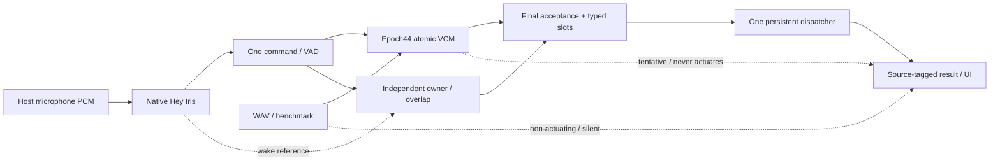

# Iris

**Say Hey Iris. Give a supported command. Iris recognizes it locally and shows what happened.**

A finite voice-command model: **258,912 parameters · original epoch 44 · FP32 · 31 commands + UNKNOWN**. Recognition is local; optional services supply actions and external data. No transcript, ASR or LLM runs in the product. **Wake smoke gate FAILED; no replacement was promoted. This is an unqualified research build, not a working-acoustic-release claim.** Pi and fresh human live-microphone reliability remain unmeasured.

[Presentation](docs/site/index.html) · [Getting started](docs/IRIS-GETTING-STARTED.md) · [Model card](docs/MODEL-CARD-iris-epoch44.md) · [Verified JSON](docs/site/assets/iris.json)

## Quickstart

Use Python 3.13, uv and the pinned runtime. First use `python inference.py --check` for the launcher's setup path; setup may access the network. Once installed:

```sh
python inference.py --check --no-setup
python inference.py --mode ui --no-setup
python inference.py --wav /absolute/path/to/mono16k.wav --no-setup
```

Use your environment's Python explicitly (`.venv/Scripts/python.exe` on Windows, `.venv/bin/python` on POSIX). The default is `submission/models/optionb-tiny`, ONNX CPU. Checks/WAVs stay silent and action-free; microphone actions require explicit enablement and guards. Optional providers can require network access even though recognition is local.

Prepare actual evaluation audio **without fitting**, using the [pinned original source/environment](docs/IRIS-GETTING-STARTED.md#prepare-original-evaluation-inputs-without-fitting). From this publication checkout, the wrapper delegates to the unchanged original preparer and exports portable manifests:

```sh
python -B reproduce.py prepare-evaluation \
  --source-checkout PINNED_SOURCE --source-python PINNED_PYTHON \
  --output .cache/iris-publication-evaluation/run-01
python benchmark.py --model-choice epoch44 \
  --manifest PATH --data-root PINNED_SOURCE --output NEWDIR --repeats 3
```

Use the actual pinned source revision `3c05b3beb46f06c3108089e0d8c79474670c6cb7` and its Python for `PINNED_SOURCE`/`PINNED_PYTHON`. Set `PATH` to `PINNED_SOURCE/.cache/iris-publication-evaluation/run-01/portable/human-test-holdout.jsonl`; `NEWDIR` must be new. Metadata alone is not audio. [Full setup, exact original prepare command and action boundaries](docs/IRIS-GETTING-STARTED.md).

## Pipeline



One wake owns one command. The acoustic decision, owner veto and action outcome are separate. One host-owned playback path provides wake acknowledgment, intent beep and completion cue only after the final result. Unknown provider outcomes remain unknown and are not retried automatically.

## Model


Two depthwise/pointwise stages per block; kernel 7, dilation 1/2/4/8, LayerNorm and SiLU. Class 0 is UNKNOWN. **18 intent families and 93 wording definitions are not 93 transcript outputs.** Graph:1,082,940 bytes; five-file bundle:1,088,682 bytes. Native wake82,114 parameters, owner129,985 runtime parameters and separate 2.33 MB VAD graph are **additional** costs. [Exact hashes, architecture and limits](docs/MODEL-CARD-iris-epoch44.md).

## Ten use cases

All31 positive classes are assigned exactly once by the [generator/tests](scripts/iris_publication_data.py). The [deck](docs/site/index.html#uses) shows ten selectors in one pipeline/JSON/output frame. These are **supported wording definitions and illustrated outputs**, not observed recognition/provider results.

| ID | Category | Output/source boundary |
|---|---|---|
| UC-01 | Music | Synthetic playback / Playing · demonstration only |
| UC-02 | Questions | Synthetic weather / Weather unavailable |
| UC-03 | Lights | Synthetic light / Lamp on · simulated |
| UC-04 | Dim / color | Synthetic light / 20% · red · simulated |
| UC-05 | Timer | Local job example / 0:10 |
| UC-06 | Alarm | Local job example / 06:00 · Asia/Manila |
| UC-07 | Temperature | Synthetic target / 22°C target |
| UC-08 | Media | Synthetic playback / Paused · simulated |
| UC-09 | Reminders | Local job example / Study |
| UC-10 | Calls / messages | Synthetic camera / notice / Home camera · video only |

<details>
<summary>Ten mini diagrams, exact JSON and honest example outputs</summary>

**UC-01 · Music — “Play music”**


`{"intent":"PLAY_MUSIC","slots":{}}` → **Synthetic playback: Playing · demonstration only.** No audio is playing. A configured provider must supply its actual result.

**UC-02 · Questions — “Weather” / “Time”**


`{"intent":"WEATHER","slots":{}}`; `{"intent":"TIME","slots":{}}` → **Synthetic weather: Weather unavailable.** No current observation. OpenWeather → honestly dated cache → labeled synthetic fallback. Time uses the local Manila clock.

**UC-03 · Lights — “Turn on the lights”**


`{"intent":"LIGHT_ON","slots":{"light_id":"light.all"}}` → **Synthetic light: Lamp on · simulated.** Target light.hue_color_lamp_1. No device changed; a provider acknowledgment is not an observed state.

**UC-04 · Dim / color — “Brightness 20 percent” / “Change color to Red”**


`{"intent":"BRIGHTNESS","slots":{"light_id":"light.all","percent":20}}`; `{"intent":"COLOR","slots":{"light_id":"light.all","color":"red"}}` → **Synthetic light: 20% · red · simulated.** Finite brightness 20 / 60 / 100%; colors red / blue / green. No device changed.

**UC-05 · Timer — “Timer 10 seconds”**


`{"intent":"TIMER","slots":{"duration_seconds":10}}` → **Local job example: 0:10.** Example of a saved ten-second countdown. This static deck starts no job; the application persists jobs and due alerts.

**UC-06 · Alarm — “Alarm 6:00 AM”**


`{"intent":"ALARM","slots":{"time":"06:00","timezone":"Asia/Manila"}}` → **Local job example: 06:00 · Asia/Manila.** Next matching Manila deadline, not a fixed UTC offset guessed by the deck. No alarm is scheduled here.

**UC-07 · Temperature — “Temperature 22 degrees”**


`{"intent":"TEMPERATURE","slots":{"degrees":22,"unit":"C"}}` → **Synthetic target: 22°C target.** Observed home sensor: unavailable. No climate service is called. Target and real measured temperature stay separate.

**UC-08 · Media — “Pause” / “Next song” / “Volume up”**


`{"intent":"PAUSE","slots":{}}`; `{"intent":"NEXT","slots":{}}`; `{"intent":"VOLUME","slots":{"operation":"up"}}` → **Synthetic playback: Paused · simulated.** Provider semantics apply: Spotify STOP is pause, not a claimed device stop. No playback changed here.

**UC-09 · Reminders — “Remind me to Study” / “List my reminders”**


`{"intent":"CREATE_REMINDER","slots":{"task_id":"task.study"}}`; `{"intent":"LIST_REMINDERS","slots":{}}` → **Local job example: Study.** Finite tasks: drink water / study / exercise. The application persists the list; this example writes nothing.

**UC-10 · Calls / messages — “Call” / “Message”**


`{"intent":"CALL","slots":{"contact_id":"contact.home"}}`; `{"intent":"MESSAGE","slots":{}}` → **Synthetic camera / notice: Home camera · video only.** Target camera.dining_area_main_camera_tc70_mainstream. No telephone call, stream or notification is started by this deck.

</details>

Voice values stay finite: timers10/30/60s; alarms06:00/08:00/21:00 Manila; temperatures18/22/26°C; brightness20/60/100%; red/blue/green; drink water/study/exercise. Broader touch/configuration controls do not create acoustic recognition.

## Data, training and testing

| Split | Human | Synthetic |
|---|---:|---:|
| TRAIN |1,889|21,426|
| DEV |256|995|
| Calibration |210|0|
| TEST |1,050|3,368|
| HOLDOUT |96|100|

TRAIN uses 1,889 human +5,982 synthetic primary rows and 15,444 supplemental synthetic rows; [exact revisions/terms](docs/IRIS-CITATIONS.md). Only human TRAIN fits normalization. Original recipe: seed 53, CPU/four Torch threads,6 human +42 mixed epochs,96 batches/epoch,32 samples/batch, AdamW,4,608 updates,2,987.91s fit. [Actual curve/summary](presentation/evidence/manifest.json).

| Reproducibility statement | Status |
|---|---|
| Exact original artifact verification/loading | PASS: `python -m scripts.optionb_epoch44 verify --load` |
| Original source/features | Hash-bound pinned-source reconstruction evidence |
| GPU-to-GPU repeatability | Two historical full fits matched; selected epoch 28 |
| Exact original CPU epoch 44 retraining | **Not verified; comparison failed. No success lock is invented.** |

The [original-source runbook](docs/REPRODUCIBILITY-optionb-epoch44.md) preserves failures; benchmarking is a separate lane. No model/policy is retuned for these exposed cohorts:

| Cohort | Correct accepts / positives | Wrong accepts, including negatives | Negative false accepts | Ambiguous, unscored |
|---|---:|---:|---:|---:|
| HOLDOUT |72/80|3|1/14|2|
| TEST |393/609|59|24/256|185|

Exact metadata-wording subsets:58/62 and 173/232, not full 93-wording human coverage;21 definitions lack exact human references. Fresh human wake/command, ownership and Pi qualification remain unmeasured. **New synthetic wake study failed:** existing native wake detected 1/32 positives with 0/68 false wakes; the separately trained same-size companion detected 21/32 with 2/68 false wakes. **Neither passed; no replacement was promoted.** [Actual wake receipt](presentation/evidence/wake-smoke-status.json). Historical17/32 calibration is a different cohort, not the new gate. Static-site/software checks cannot turn this into an acoustic release pass.

## Desktop benchmark

| Actual run | p50 / p95 recognition latency |
|---|---:|
| Historical original PC |4.82 /8.41 ms|
| Historical later repeat v2 |5.36 /8.69 ms|
| 2026-10-24 reference driver, **under publication load** |9.34 /15.34 ms|
| Current adapter, product lock (**not quiesced**) | 5.3902499967080075 / 10.56562999983725 ms |
| Raspberry Pi |**Not measured — `pi:null`**|

Current environment: NumPy 2.5.3 / ONNX Runtime 1.30.0; peak whole-process RSS **84.6796875 MiB**, not model-only RAM. [Actual audited receipt](presentation/evidence/desktop-product.json): all 1,146 WAV/decoded-PCM identities and 3,438 complete typed outputs independently matched frozen gold. Direct VCM only; wake/owner/UI/providers and speaking time excluded. This does not improve the failed wake gate.

The historical and original-reference runs use Intel Core i7-11700/Windows 11/Python 3.13.14, CPUExecutionProvider, one ONNX/frontend BLAS thread; all named runs use 1,146 original human recordings ×3 =3,438 calls. Repeats do not inflate accuracy denominators. Scope: PCM validation, frontend, normalization, ONNX and finite decision; **excludes** speech, decode, wake/VAD waiting, worker/gateway/UI, audio and providers. The new reference run is not quiesced, not the new adapter and not end-to-end latency. No unrelated256-DEV memory probe is called full-PC memory. [Receipts/hashes](docs/site/assets/iris.json).

## Limits and real versus synthetic

Only enabled final live microphone commands may actuate after guards. Tentative previews, WAVs, checks and benchmarks never do. Missing providers show **Synthetic — no device changed**, not a real acknowledgment. Unknown outcomes remain unknown. OpenWeather caches keep honest timestamps; thermostat targets are synthetic only, separate from observed sensors. Recognized lights bind to the Hue lamp; CALL opens the dining camera **video only**, not telephony.

No arbitrary names, songs, numbers, dictation or general search. Setup/providers are not an offline/privacy absolute. Data-specific research, non-commercial and consent restrictions remain; no blanket MIT license is claimed for weights/recordings.

## Development and rollback

[Render/source instructions](presentation/README.md) · [Citation audit](docs/IRIS-CITATIONS.md) · [Release log](docs/RELEASE-iris-publication-v1.md) · [Revert guide](docs/REVERT-iris-publication-v1.md). Historical [root model card](MODEL_CARD.md), [dataset directory](docs/DATASETS.md) and [experiment index](EXPERIMENTS.md) are preserved; their969k/2M results do not describe this VCM.

```sh
python -B scripts/iris_publication_data.py --check
python -B -m unittest scripts.test.test_iris_publication_data -v
python -B presentation/validate.py
```

## Citation

Cite the exact repository revision and frozen model hash. Primary dataset: **DOI[10.57967/hf/10723](https://doi.org/10.57967/hf/10723)**, revision `25111444af3adff7588d86ab27c304bb080895cf`. Supplemental:[`martinnavs/ai231-fil-supplemental-data`](https://huggingface.co/datasets/martinnavs/ai231-fil-supplemental-data/tree/230c8b8d58caf78e4bc90886d9c6fa77fe6024b8), revision `230c8b8d58caf78e4bc90886d9c6fa77fe6024b8`. Retain original-source attribution, consent and research-use restrictions; the [audit](docs/IRIS-CITATIONS.md) distinguishes actual membership from wider sources.

```bibtex
@software{iris_epoch44_2026,
  author = {{Iris project contributors}},
  title = {Iris: Original OptionB Epoch44 Finite-Command Smart Speaker},
  year = {2026},
  url = {https://github.com/justinruaya123/smart-speaker},
  version = {OptionBTinyVCM-1 epoch44},
  note = {258912 parameters; FP32; graph SHA256 c1cd773b92337fd2a453554b047fa555c692fb981b5975700a32260388d4b9ce; cite exact source revision used}
}
```
