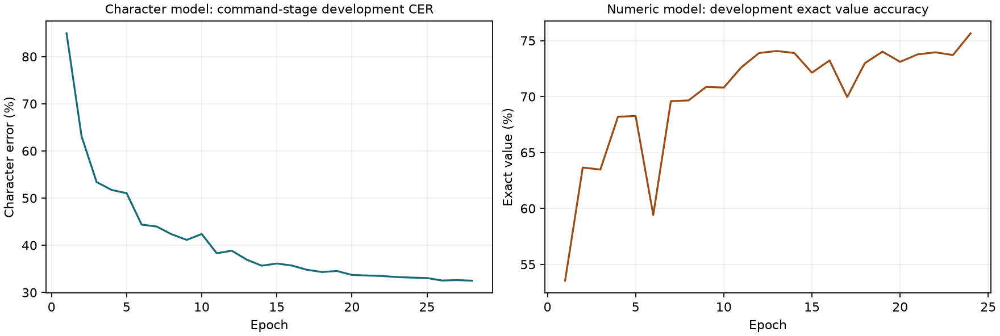
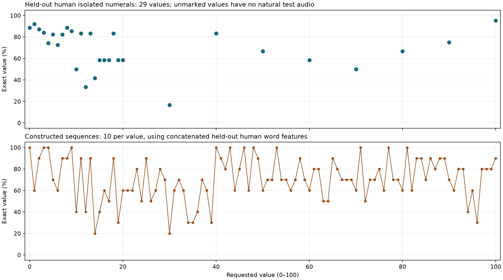

> Historical isolated research. The current human-only comparison and ASR retirement are documented in [alternatives/REPORT.md](alternatives/REPORT.md). Earlier integration boundaries and model-selection commands below describe their original experiment.

# STT research: spoken music requests and volume values 0–100

Research and experiments completed 19 September 2026. Everything produced for this investigation is inside `STT/`. The existing speaker pipeline was not changed or integrated. The scope is English speech describing songs/artists and numeric commands; recognizing a recording of a song, humming, or lyrics is a different task.

## Findings

**A dynamic song corpus is technically feasible without retraining the acoustic model, but this scratch-trained baseline does not establish reliable spoken-song recognition.** The fixed catalog recovered 5/96 reference entities; the updated catalog recovered 5/96. In the separate control using correct text instead of recognized speech, adding catalog names recovered 5/8 newly introduced entity occurrences. The update mechanism therefore works at the text/catalog layer; the measured speech result remains inadequate.

**A small spoken-word vocabulary can represent every integer from 0 through 100, but representation coverage is not recognition accuracy.** The independent numeric model achieved 81.5% exact-value accuracy on 1,148 held-out human isolated numeral recordings and 70.6% on 1,010 constructed sequences. Natural human test audio covers 29 elementary values; 72 compound values have only constructed sequence evidence. The numeric model recovered 0/4 values from available held-out natural full volume commands; the character model recovered 0/4. This small sample cannot estimate general volume-control reliability.

Two approximately 2.08-million-parameter models were actually trained from random initialization. This is an exploratory result from one seed, short training schedules, and limited data. It is not evidence that catalog biasing or scratch STT is inherently infeasible; it shows that these particular models/data do not meet the experiment's screening targets.

## What a vocabulary can and cannot teach

A **text vocabulary** supplies possible spellings, names, aliases, and permitted numeric forms. It can update a decoder's language model, contextual phrase list, pronunciation lexicon, or downstream catalog matcher. It does not itself supply evidence of what words sound like. Acoustic training needs labeled speech, or a separate self-supervised audio objective with substantial unlabelled speech. The character model here first learns from spoken digits and then from complete commands; no pretrained external weights are used.

A **finite word output vocabulary** is a useful fit for numerical parameters: zero–nineteen, twenty/thirty/forty/fifty/sixty/seventy/eighty/ninety, and hundred give 29 lexical items. The model has 31 outputs including CTC blank and an unknown class. A strict grammar maps permitted sequences to integers and rejects invalid/out-of-range text. The parser also accepts text variants such as `one hundred`, but the numeric acoustic vocabulary does not include every optional word, such as `a` or `and`.

A growing collection of song names is a different vocabulary problem. Treating each complete song title as a classifier class requires new classes and usually new labeled audio when songs are added. Character/subword recognition with a replaceable contextual catalog supports new combinations without changing the output layer. Unfamiliar pronunciations, homophones, duplicate titles, non-English names, and recognition errors can still defeat catalog matching. Established contextual ASR work supports this direction; the simple matcher tested here is not a reproduction of a full contextual decoder. [Contextual speech recognition study](https://www.isca-archive.org/interspeech_2019/zhao19d_interspeech.html).

Updating the **training corpus** means adding recordings/transcripts, then fitting and reevaluating a versioned model. Updating the **inference catalog** means replacing names/aliases and rebuilding an index while keeping model weights fixed. Only the latter was simulated for the dynamic-feature comparison. No Spotify API calls, playlist reader, folder watcher, or user filepath ingestion were implemented.

## Dataset investigation and acquisition

The survey covers **35 resources**, including related dataset variants, text-only corpora, and supporting metadata/noise resources. This is a broad search, not a claim of exhaustive coverage or 35 independent speech datasets. Primary publisher/repository links, modality, domain fit, access, and actual acquisition status are recorded below and in [dataset_catalog.json](dataset_catalog.json).

The most useful next human-speech sources are SLURP for full music requests, MLEnd/MSWC for numeric words, and the Sonos SmartSpeaker evaluation set for artist requests. Sonos' training ontology includes volume and PlayMusic labels, but the released human SmartSpeaker recordings described by the publisher are test recordings of artist requests; its volume training text is not a ready-made full 0–100 volume audio corpus. [Sonos dataset description](https://github.com/sonos/spoken-language-understanding-research-datasets).

### Data actually pulled

- **FSDD:** complete pinned archive and all 3,000 human digit WAVs, freshly downloaded.
- **MLEnd:** 1,711 selected human numeral WAVs, freshly downloaded, covering 29 values and 151 speakers before cleanup. Two byte-identical files with conflicting value labels were quarantined; they were development examples, not test examples.
- **MSWC:** verified English split metadata plus **5,000** complete, decodable clips: 1,000 each for eight, hundred, ten, play, and song. The frozen numeric experiment uses **900** clips, 450 each for eight and hundred, because that manifest was frozen before later downloads finished. The remaining completed clips are available locally but not credited as training data.
- **SLURP:** pinned annotations/metadata downloaded; **1 complete audio parquet shard** downloaded and checksum-verified after the training manifest was frozen. The trained SLURP audio consists of isolated byte copies of the already available public dataset, not this later shard.
- **SpokeN-100:** README/source information only. No synthetic speech was used in either headline experiment.
- Selected existing **FSC, SmartLights, LibriSpeech, and SLURP** recordings were copied into `STT/data/audio/`. Their source files were only read; existing model weights/features were not reused.

Large archive transfers repeatedly timed out or ended early. Download jobs were stopped after preserving completed files. Approximately **2.59 GiB** of resumable `.part` files remain under `STT/data/raw/`; these are incomplete and excluded from training. The Google Speech Commands archive did not complete. No gated account registration, access application, purchase, or contact with dataset owners occurred. [Acquisition receipts and inventory](evidence/acquisition_final.json), [MSWC per-clip inventory](data/mswc_downloaded_inventory.jsonl).

The completed files used for training remain in STT, together with hashes and frozen manifests. Catalog names are a controlled SLURP-based fixture, not data pulled from a Spotify account. Dataset access/licensing notes below describe research reuse constraints, not permission to redistribute all downloaded data or trained artifacts commercially.

### Survey

| Resource / primary source | Fit and limitations | Access / use terms | Actual status |
| --- | --- | --- | --- |
| [SLURP real](https://github.com/pswietojanski/slurp) | Human assistant requests with song/artist entities and some volume commands; strongest immediately usable domain match. | Audio CC BY-NC 4.0; annotations CC BY 4.0. | Fresh pinned annotations; existing public audio copied into STT and trained. One fresh audio shard also completed after manifest freeze. |
| [SLURP synthetic](https://github.com/pswietojanski/slurp) | TTS counterpart of assistant requests; possible augmentation, unsuitable as a human acceptance test. | See publisher terms for the synthetic release. | Reviewed; not used. |
| [Snips/Sonos SmartSpeaker](https://github.com/sonos/spoken-language-understanding-research-datasets) | Music and volume text labels; human audio only for the test set. English/French artist requests use a Spotify popularity list. Particularly useful external music benchmark. | Academic/research, noncommercial; access application. | Reviewed; audio not obtained. No access form submitted. |
| [Snips/Sonos SmartLights](https://github.com/sonos/spoken-language-understanding-research-datasets) | Human brightness/color requests; spoken percentages transfer to numeric recognition, but lighting is not volume. | Publisher research-only terms; mirror metadata is not a replacement license. | Existing close-microphone public audio copied and trained. |
| [Fluent Speech Commands](https://fluent.ai/fr/fluent-speech-commands-a-dataset-for-spoken-language-understanding-research/) | 30,043 utterances, 97 speakers, 31 intents. Useful playback/relative-volume command wording; lacks unrestricted song titles. | Academic research license. | Existing selected public audio copied and trained; inherited repeated rows removed. |
| [Meta fair-speech](https://ai.meta.com/datasets/speech-fairness-dataset/) | 26,471 assistant utterances from 593 speakers across seven domains including music; useful demographic evaluation. | Publisher evaluation/use terms must be followed. | Reviewed; not acquired or mixed into training. |
| [Speech-MASSIVE](https://huggingface.co/datasets/FBK-MT/Speech-MASSIVE) | Human speech plus assistant intents/slots in 12 languages; the listed languages do not include English. Relevant to future multilingual work. | CC BY-NC-SA 4.0. | Reviewed; not acquired. |
| [MASSIVE](https://github.com/alexa/massive) | More than one million multilingual text utterances with intents/slots; useful grammar and entity examples, not acoustic training speech. Derived from SLURP. | CC BY 4.0; see release terms. | Reviewed; not acquired. |
| [Snips NLU benchmark](https://github.com/sonos/nlu-benchmark) | Text intents including PlayMusic and song/artist slots; useful parser vocabulary. Do not confuse it with human SmartSpeaker recordings. | See repository data terms. | Reviewed; not acquired. |
| [Audio-Snips / AWS noisy SLU](https://github.com/aws-samples/aws-lex-noisy-spoken-language-understanding) | SNIPS utterances synthesized with Amazon Polly voices; useful controlled augmentation, not independent human speech. | Repository lists CC0; verify the specific audio release terms. | Reviewed; not acquired. |
| [Free Spoken Digit Dataset (FSDD)](https://github.com/Jakobovski/free-spoken-digit-dataset) | 3,000 human isolated digits, six speakers, 8 kHz. Small, direct 0–9 baseline; cannot establish 10–100 accuracy. | CC BY-SA 4.0. | Full pinned archive freshly downloaded; all 3,000 recordings used with held-out speakers. |
| [Google Speech Commands v2](https://www.tensorflow.org/datasets/catalog/speech_commands) | Human isolated keyword classification, 35 words including zero–nine. No tens/hundred coverage. | CC BY 4.0. | Archive acquisition queued/attempted; no completed archive used. Existing root keyword data deliberately not counted as a fresh pull. |
| [Multilingual Spoken Words Corpus (MSWC)](https://mlcommons.org/datasets/multilingual-spoken-words/) | 23.4 million word examples across 50 languages; aligned Common Voice crops. Useful numeric words and media vocabulary, but word crops lose natural coarticulation. | CC BY 4.0. | Fresh split metadata plus 5,000 completed selected English clips. Frozen numeric run uses 900 eight/hundred clips. |
| [MLEnd Spoken Numerals](https://mlenddatasets.github.io/spoken_numerals/) | Over 32,000 human numeral recordings with varied speakers/intonations. Selected 29 elementary values cover zero–nineteen, tens, and hundred. | Publisher promotes ML use; explicit speech-data license not located in the pinned GitHub snapshot. Python package MIT is not a speech-data license. | Fresh 1,711 selected WAVs. Two identical files carrying conflicting numeric labels quarantined from evaluation. |
| [SpokeN-100](https://github.com/ankilab/SpokeN-100) | 12,800 artificial numeral recordings from 32 voices/four languages, numbers 0–99. Does not include 100 or independent human voices. | Consult dataset/Zenodo release terms. | Fresh README only; audio not downloaded or used. |
| [Sheffield Numbers Corpus (SNuC)](https://orda.shef.ac.uk/articles/dataset/SNuC_The_Sheffield_Numbers_Spoken_Language_Corpus/19673772) | Human connected alphanumeric sequences, over 13,000 recordings/about 20 hours. Useful sequence decoding; not balanced volume percentages. | CC BY-NC 4.0. | Reviewed; approximately 9.8 GB release not acquired. |
| [TIDIGITS](https://catalog.ldc.upenn.edu/LDC93S10) | Human connected digits from adults/children; useful sequential digit models. Digit strings are different from English cardinal quantities. | LDC licensed access. | Reviewed; not obtained. |
| [CSLU Numbers](https://catalog.ldc.upenn.edu/LDC2009S01) | Telephone numbers, cardinal/ordinal quantities and digit strings. Useful numeric variation with telephone channel mismatch. | LDC licensed access. | Reviewed; not obtained. |
| [Common Voice Single Word](https://mozilladatacollective.com/datasets/cmkzhp64p00wlno07elrmt20y) | Human short words including digits; useful accent variation but insufficient tens/compound-number coverage. | CC0 release; current distribution access conditions apply. | Reviewed; not obtained. |
| [Spiking Heidelberg Digits (SHD)](https://zenkelab.org/resources/spiking-heidelberg-datasets-shd/) | Spoken English/German digits represented for spiking-network tasks. Limited to digits, not 0–100 cardinals. | See publisher data terms. | Reviewed; not selected for this waveform CTC experiment. |
| [LibriSpeech](https://www.openslr.org/12/) | Approximately 1,000 hours of human English audiobook speech; useful broad acoustic/word training, less representative of music commands. | CC BY 4.0. | Existing selected audio copied; 1,266 recordings pass the duration filter and are used. |
| [Mini LibriSpeech](https://www.openslr.org/31/) | Small LibriSpeech subset for fast experiments; overlaps its parent corpus and must not be treated as independent evidence. | Same source family; see release page. | Reviewed; not separately acquired. |
| [Multilingual LibriSpeech (MLS)](https://www.openslr.org/94/) | Large multilingual audiobook speech, including English. Useful for larger scratch acoustic training; substantial storage/compute. | CC BY 4.0. | Reviewed; not acquired. |
| [Mozilla Common Voice](https://mozilladatacollective.com/datasets?q=common+voice) | Crowdsourced human read speech with accent variation. Shares parent data with MSWC; cross-corpus overlap needs checking. | CC0 releases; current distribution account/access conditions apply. | Reviewed; no new account or gated download. |
| [GigaSpeech](https://github.com/SpeechColab/GigaSpeech) | 10,000-hour English corpus with smaller subsets; broader vocabulary and proper names, domain mismatch remains. | Publisher access/license conditions. | Reviewed; not acquired. |
| [The People's Speech](https://github.com/mlcommons/peoples-speech) | Large English transcribed speech collection; useful scaling candidate. Alignment quality and source-specific terms require filtering. | CC BY / CC BY-SA components; check selected subset. | Reviewed; not acquired. |
| [SPGISpeech](https://huggingface.co/datasets/kensho/spgispeech) | 5,000 hours of transcribed financial speech; useful numeric normalization and names but different from home commands. | Publisher dataset agreement / gated access. | Reviewed; not obtained and no contact information submitted. |
| [FLEURS](https://huggingface.co/datasets/google/fleurs) | Multilingual human read-speech benchmark, including English and Filipino. Filipino-language audio is not evidence for Philippine-accented English. | CC BY 4.0. | Reviewed; not acquired. |
| [VoxPopuli](https://github.com/facebookresearch/voxpopuli) | Large parliamentary speech collection with labeled/unlabeled portions; potential acoustic pretraining, substantial domain mismatch. | See publisher source/release terms. | Reviewed; not acquired. |
| [VCTK](https://datashare.ed.ac.uk/items/30e7453c-9ea8-48b4-8e18-f96d0dc62928) | Human English read speech from multiple accents/speakers. Useful pronunciation and speaker variation, not song requests. | CC BY 4.0 release. | Reviewed; not acquired. |
| [LJ Speech](https://keithito.com/LJ-Speech-Dataset/) | 13,100 clips from one reader. Public-domain speech for pipeline checks; weak evidence for unseen-speaker command recognition. | Public domain as described by publisher. | Reviewed; not acquired. |
| [TED-LIUM](https://www.tensorflow.org/datasets/catalog/tedlium) | Human English talks with broad vocabulary/proper names. Useful ASR training, weak match for short commands. | CC BY-NC-ND 3.0 as listed for this release. | Reviewed; not acquired. |
| [MUSAN](https://arxiv.org/abs/1510.08484) | Music, speech and noise useful for augmentation/negative examples; does not provide the required command transcripts. | Check component licenses before use. | Reviewed; not acquired. |
| [MLEnd Hums and Whistles](https://mlenddatasets.github.io/hums_whistles/) | Hum/whistle recordings of a small song set; useful for melody identification, a different task from recognizing spoken song names. | See publisher dataset terms. | Reviewed; not acquired. |
| [MusicBrainz metadata](https://musicbrainz.org/doc/About/Data_License) | Song/artist names can supply a hypothetical dynamic vocabulary. Metadata supplies no pronunciation training audio and no Spotify account integration. | Core metadata CC0; supplementary data CC BY-NC-SA 3.0. | Reviewed only; catalog fixtures here use SLURP entities. |

## Training data and leakage controls

The character experiment uses **26,475 unique recordings**, about **19.67 hours** across all partitions. Counts below are after duration/alignment filtering and byte-level duplicate removal. These are custom experimental subsets, not published benchmark test scores.

| Source | Train | Development | Test | Total |
| --- | --- | --- | --- | --- |
| SLURP-real | 7179 | 1917 | 1185 | 10281 |
| FluentSpeechCommands | 8033 | 1272 | 1750 | 11055 |
| SnipsSmartLights | 533 | 285 | 55 | 873 |
| LibriSpeech | 1017 | 124 | 125 | 1266 |
| FSDD | 2000 | 500 | 500 | 3000 |

The numeric manifest contains **7,547 unique recordings**, including human nonnumeric rejection examples. It reuses some recordings from the character experiment, so adding the two manifest sizes would double-count audio. Across both frozen manifests there are **29,084 unique audio hashes**. Numeric split counts and the 29-word vocabulary are in [numeric configuration](runs/numeric_ctc/config.json).

Speakers are assigned deterministically by a hash into train/development/test; FSDD instead explicitly holds out Theo for development and Yweweler for test. Speaker identifiers and paired-recording groups do not cross partitions. One microphone is selected per SLURP take, preferring the headset recording; SmartLights uses close recordings. Source dataset partitions are not silently assumed speaker-disjoint. Identity checks use publisher IDs, not recognition of real-world individuals across unrelated corpora.

The final audit removed **4,191 repeated character-manifest rows** and **62 repeated numeric-manifest rows**. It also quarantined the two conflicting MLEnd files. No identical audio hashes crossed splits. Both final models were restarted from random weights after this cleanup. Earlier diagnostic runs are archived under names ending `_unmasked` or `_resampled`; none supplies the final tables. [Deduplication evidence](evidence/deduplication.json).

Features are 80-channel log-mel spectra from mono 16 kHz audio, a 25 ms window and 10 ms hop, with per-utterance normalization. Recordings shorter than 0.12 s, longer than 14 s, or too short for their CTC targets are excluded. Source prompt text is normalized to English letters, spaces and apostrophes; it is not independently re-transcribed here. MLEnd targets are numeric category labels mapped to canonical words, not guaranteed verbatim transcripts.

Synthetic composition concatenates **features of human word recordings within the same split**. It supplies 5,050 training, 505 development and 1,010 test sequences for the numeric model. It does not recreate natural coarticulation, background conditions, command boundaries, or a complete spoken volume request. Some examples reuse the same word recordings, so their nominal counts are not independent speakers or independent speech events.

## Models investigated and the two models trained

| Model family | Fit for this investigation | Work performed |
| --- | --- | --- |
| CNN + bidirectional GRU + CTC | Small local character/word sequence model; explicit finite vocabulary or compositional text output | Implemented and trained twice independently from random weights: character and numeric models |
| [QuartzNet](https://arxiv.org/abs/1910.10261) | Separable convolutions offer an efficient CTC acoustic model for a larger training experiment | Literature investigation only |
| [Conformer](https://arxiv.org/abs/2005.08100) | Convolution plus attention can model richer speech context; requires a larger training study | Literature investigation only |
| [wav2vec 2.0](https://arxiv.org/abs/2006.11477) | Learns acoustic representations from unlabelled audio before supervised adaptation; a text word list is insufficient for that objective | Literature investigation only; no SSL pretraining or pretrained weights used |
| [Vosk/Kaldi grammar adaptation](https://alphacephei.com/vosk/lm) | Runtime grammar/language-model adaptation is relevant to dynamic catalogs; vocabulary/pronunciation support depends on the model | Documentation investigation only; no Vosk model loaded |

Both implemented models have two temporal convolutions (192 channels, first stride 2), three bidirectional GRU layers (192 hidden units per direction), layer normalization and a CTC output layer. They require an utterance and are **not streaming models**. CTC permits sequence supervision without manually supplied word timestamps. [Original CTC paper](https://www.cs.toronto.edu/~graves/icml_2006.pdf).

| Final run | Character STT | Finite-word numeric STT |
| --- | --- | --- |
| Parameters | 2,081,309 | 2,082,079 |
| Initialization | Random, seed 20260919 | Independent random initialization, same seed |
| Curriculum | 10 spoken-word epochs, then 28 command epochs | 12 word/rejection epochs, then 24 composition epochs |
| Selection | Minimum development character error | Development exact value accuracy minus a false-accept penalty |
| Selected final-stage epoch | 28 | 24 |
| Optimizer updates | 8,894 | 4,596 |
| Recorded training time | 8.62 minutes | 4.57 minutes |
| L2 parameter change from initialization | 109.485 | 64.866 |

Training used AdamW, cosine learning-rate schedules, gradient clipping and time/frequency masking. The host GPU was an RTX 4080 SUPER; download/preparation time is excluded above and concurrent host activity affects timing. Approximately 8.3 MB of float32 parameters per model does not account for activations or runtime memory. There is no Pi, embedded-device, live-microphone or Philippine-English acceptance measurement.



No test recording was used for gradient updates, epoch selection or threshold tuning. Test annotations were intentionally used only to construct the explicitly labeled catalog-membership simulation. Initial-weight digests, manifest hashes, configurations, checkpoints and completed-run evidence are retained in each run directory.

## Dynamic catalog: feature off, fixed corpus, updated corpus

The same frozen acoustic checkpoint is used in all three conditions:

1. **Off:** greedy character transcription followed by a simple music-request parser; no catalog correction.
2. **Fixed:** a 209-entry catalog of training song/artist names.
3. **Dynamic:** that catalog plus 18 additional names, for 227 entries, without fitting or changing model weights.

The additions are a deterministic half of unseen development/test entity names. This is an **optimistic controlled simulation of user-supplied catalog membership**, because held-out names are explicitly made available. Full reference sentences and audio are not supplied to the matcher. Other unseen names remain absent. It is not an independently collected playlist test.

The matcher parses only the decoded text, shortlists eight similar catalog names, and reranks replacement transcripts using the frozen model's CTC scores. A single threshold/margin selected on dynamic-catalog development examples is reused for both catalog conditions. It is a simple post-transcription correction experiment, not beam-search contextual biasing. Missing command words can prevent the parser from proposing a slot at all; aggressive name substitution can produce a wrong song.

Development selected score threshold **0.45** and margin **0.1**, yielding 14 correct and 9 wrong entity predictions, with 9.9% recall. The screening target was at least 90% accepted-entity precision with at least five correct entities, chosen for this experiment. **Selection status: Development 90% precision gate unmet; diagnostic best-F1 threshold, not an operational acceptance gate.** Such a small accepted set cannot establish reliable calibration on unseen speakers.

The held-out comparison contains **79 requests with 96 annotated song/artist entities**, plus **595 sampled other utterances without those entities**. Precision is correct emitted entities divided by all emitted entities; recall is correct emitted entities divided by reference entities. An exact title/artist string and entity type are required. The table's negative false accepts are utterances, not entity counts.

| Condition | Correct entities | Wrong entities | Entity precision | Entity recall | Negative utterances accepted |
| --- | --- | --- | --- | --- | --- |
| off | 0 | 56 | 0.0% | 0.0% | 24 |
| fixed | 5 | 16 | 23.8% | 5.2% | 13 |
| dynamic | 5 | 17 | 22.7% | 5.2% | 14 |

Newly introduced entity occurrences across all test request categories: **0/8** correctly recovered by the updated catalog. Out-of-catalog requests remain in the evaluation, and incorrect substitutions count as errors. Aggregate frame accuracy is deliberately not the headline because correctly rejecting many negative requests would conceal very poor music recall.

Examples from the held-out newly-added-catalog request group:

| Reference request | Decoded speech | Updated-catalog output |
| --- | --- | --- |
| play all indie pop songs | cn in tefm sro | {} |
| rock with rock star | ra ted grotay | {} |
| play why do you sing by kirk franklin | sty witeis in boy o tok slating | {} |
| please play the song joy to the world | please plate song di tof thele | {} |

### Text-only control

To test catalog updates independently of acoustics, the parser is also given the **correct reference transcript**. Catalog conditions accept only exact text matches in this control; this is a different, simpler matching rule than the speech experiment and must not be presented as STT accuracy.

| Condition | Correct entities | Wrong entities | Precision | Recall | New entity occurrences correct |
| --- | --- | --- | --- | --- | --- |
| off | 42 | 48 | 46.7% | 43.8% | 5/8 |
| fixed | 32 | 1 | 97.0% | 33.3% | 0/8 |
| dynamic | 37 | 1 | 97.4% | 38.5% | 5/8 |

The updated catalog binds 5 newly introduced occurrences that the fixed catalog cannot bind. The off condition can emit a raw name that is absent from the catalog; it has not resolved a canonical catalog item. Parser limitations remain even with perfect text. The fixture contains independent song/artist entities, not verified title–artist pairs or Spotify track IDs, so neither table measures actual track selection or playback success.

Rebuilding a plain in-memory dictionary was also measured:

| Entries | Median dictionary rebuild (ms) |
| --- | --- |
| 100 | 0.005 |
| 1000 | 0.057 |
| 10000 | 0.725 |

These are dictionary construction microbenchmarks only. They do **not** measure acoustic inference, phonetic indexing, CTC candidate search over 10,000 songs, file/playlist loading, or end-to-end latency. The matcher scans names and has not been benchmarked for a production-sized catalog. The acoustic checkpoint hash remains unchanged across catalog conditions. [Protocol checks](evidence/protocol_checks.json).

## Numbers: all 101 values represented, limited natural-speech evidence

The numeric model's held-out results are:

| Test set / source | Examples | Exact values correct | Exact-value accuracy |
| --- | --- | --- | --- |
| Human isolated numerals | 1148 | 936 | 81.5% |
| Constructed word sequences | 1010 | 713 | 70.6% |
| FSDD | 500 | 436 | 87.2% |
| MLEndSpokenNumerals | 348 | 227 | 65.2% |
| MSWC-English | 300 | 273 | 91.0% |

The source rows are components of the isolated-human total, not additional independent tests. MSWC's high result covers only eight and hundred and must not be described as 0–100 accuracy. FSDD's test comprises one held-out speaker. MLEnd broadens value/speaker coverage but its canonical category labels do not verify the exact spoken wording.

The development search for a **95% accepted-value precision** threshold failed. The reported threshold is 0; zero is a diagnostic fallback, not a recommended control threshold. At this setting the model falsely accepts **1/245** natural nonnumeric test requests. Nonnumeric evaluation does not include a comprehensive silence/noise/out-of-range speech suite.

All 101 text values pass grammar round trips, including explicit 100 support. Invalid negative, fractional, ambiguous, and greater-than-100 **text** cases are rejected by the protocol checks. This is parser correctness, not proof that out-of-range **audio** will be rejected after a recognition error.



The numeric model recovered **0/4** values when applied to the available full natural volume requests. The character model recovered **0/4**. Those requests cover 1, 10, 20, 90; they do not establish all-value reliability. A parameter-only numeric recognizer would need a verified parameter audio boundary; no word timings were invented from SLURP text spans. [Full-command numeric predictions](runs/numeric_ctc/natural_volume_predictions.jsonl).

The per-value results for **every value 0–100**, including missing natural coverage, are preserved in [numeric evaluation](runs/numeric_ctc/evaluation.json). A useful next test would collect naturally spoken full commands and verified parameter slices for all 101 values across held-out speakers, microphones and noise conditions. Constructed concatenations can support training/debugging, but they cannot replace that acceptance test.

## General transcription diagnostics

| Source | Held-out utterances | Word error rate | Character error rate | Exact transcript |
| --- | --- | --- | --- | --- |
| FSDD | 500 | 22.2% | 16.0% | 77.8% |
| FluentSpeechCommands | 1750 | 6.9% | 2.8% | 82.4% |
| LibriSpeech | 125 | 90.8% | 44.6% | 0.0% |
| SLURP-real | 1185 | 78.5% | 43.4% | 5.0% |
| SnipsSmartLights | 55 | 47.4% | 19.9% | 12.7% |

The character model's pooled WER is 51.1%, but task decisions must use music entity and numeric-value results above. Simple recurring FSC phrases are much easier than rare names or audiobook sentences. Poor SLURP/name transcription explains why dynamic catalog additions do not reliably produce correct spoken entities. The word-pretraining curriculum was executed, but its causal benefit was not isolated with a separate no-word-pretraining ablation.

## Feasibility decision and next evidence needed

**Proceed as an isolated research direction; do not promote these checkpoints into the current pipeline.** Dynamic catalog updates are a suitable design for changing song names and do not inherently require acoustic retraining. This experiment demonstrates the mechanics and exposes the current acoustic/parser bottleneck. A larger speaker-disjoint music-command corpus, pronunciation-aware or contextual decoding, and canonical title/artist ambiguity handling should be tested before drawing a stronger conclusion.

For 0–100, retain a compositional finite grammar and explicit rejection, but train/evaluate on natural connected number speech and real command contexts. Prefer exact value precision/recall, all-value coverage, unknown rejection and held-out speakers over aggregate word accuracy. The screening targets used here are research choices, not a claimed production safety standard.

Adding many more general-ASR hours may improve acoustics, but a vocabulary list alone cannot solve pronunciation, coarticulation, or domain mismatch. The most valuable missing evidence is natural spoken song/artist requests and complete volume commands—not additional duplicate recordings or text-only catalog names.

## Reproduction and artifacts

The existing `.venv` was used as a read-only runtime. No dependency installation, root manifest, root lockfile, deployment bundle or pipeline configuration was changed. Recorded versions: Python 3.12.13, PyTorch 2.13.0+cu130, NumPy 2.5.3, SciPy 1.18.1, SoundFile 0.14.0, einops 0.8.2.

From the repository root in PowerShell, the frozen-manifest experiments can be rerun with:

```powershell
$env:PYTHONDONTWRITEBYTECODE = '1'
$env:OPENBLAS_NUM_THREADS = '1'
$env:OMP_NUM_THREADS = '1'
.\.venv\Scripts\python.exe STT\train.py
.\.venv\Scripts\python.exe STT\numeric_experiment.py
.\.venv\Scripts\python.exe STT\evaluate.py
.\.venv\Scripts\python.exe STT\protocol_checks.py
.\.venv\Scripts\python.exe STT\final_audit.py
.\.venv\Scripts\python.exe STT\build_report.py
```

These commands overwrite the corresponding STT run outputs. The present report is reproducible from the frozen manifests and downloaded audio; GPU executions need not be bit-for-bit identical. Do not rerun acquisition/preparation when reproducing these exact results: later downloads would change the available corpus. `deduplicate_frozen.py` is an audited one-time migration of the inherited manifest, not a regular training step. Acquisition scripts are retained separately for future new versions; they are not Spotify/file catalog integrations.

| Artifact | Location |
| --- | --- |
| Dataset survey | [dataset_catalog.json](dataset_catalog.json) |
| Character corpus and audio hashes | [data/manifest.jsonl](data/manifest.jsonl) |
| Numeric corpus and audio hashes | [data/numeric_manifest.jsonl](data/numeric_manifest.jsonl) |
| Frozen catalog fixtures and protocol | [catalogs/protocol.json](catalogs/protocol.json) |
| Character checkpoint | [runs/scratch_ctc/commands_best.pt](runs/scratch_ctc/commands_best.pt) |
| Numeric checkpoint | [runs/numeric_ctc/compositions_best.pt](runs/numeric_ctc/compositions_best.pt) |
| Detailed speech/catalog predictions | [runs/scratch_ctc/catalog_predictions.jsonl](runs/scratch_ctc/catalog_predictions.jsonl) |
| Numeric predictions, confidence and composition components | [runs/numeric_ctc/predictions.jsonl](runs/numeric_ctc/predictions.jsonl) |
| Final checks and environment | [evidence/final_validation.json](evidence/final_validation.json) |
| Acquisition status / hashes | [evidence/acquisition_final.json](evidence/acquisition_final.json) |
| Isolation verification | [evidence/pipeline_isolation.json](evidence/pipeline_isolation.json) |

Character checkpoint SHA-256: `c7e92e93509d0bff804d20505bdb79db197d14187c34f6f4856ca6ca66c4d7c0`. Numeric checkpoint SHA-256: `de49e2c50bdf53370c8a685e125f0ee907341add384b8cd4326b96fef24b9453`. Manifest hashes are recorded in both configurations and [final validation](evidence/final_validation.json).

Final isolation audit: **40,015 existing pipeline files compared, 0 changed, 0 added and 0 removed outside STT** within the audited scope. 64 non-audio files were content-hashed; existing audio files were compared by byte count and modification time. Git internals, the environment/cache, and STT itself are excluded from that snapshot. Pre-existing uncommitted work was preserved. The trained models, data, scripts, report and figures stay in STT.
