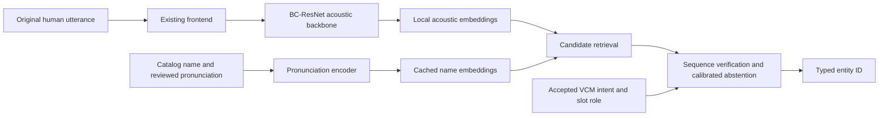

# BC-ResNet and text-enrolled music names

Investigated 20 September 2026: [Broadcasted Residual Learning for Efficient Keyword Spotting](https://arxiv.org/abs/2106.04140), Interspeech 2021, current arXiv revision v4; [paper PDF](https://arxiv.org/pdf/2106.04140). This is a paper and reference-code investigation, not a local BC-ResNet training run. The fitted candidates in this study are temporal embedding encoders, not reproductions of BC-ResNet.

**BC-ResNet is a worthwhile small acoustic backbone to compare. Its published fixed-keyword classifier does not supply the audio–text alignment required to add new artists from text.** That distinction determines how to use the paper in this project.

The paper combines frequency processing with cheap temporal residuals. It averages frequency after a frequency-wise operation, processes time, then broadcasts the result back over frequency. The block also retains a frequency-aware residual. This reduces work in temporal/pointwise layers while preserving a two-dimensional acoustic path. The reported benchmark has ten commands plus unknown and silence, using one-second recordings. These are fixed-class results, not artist-name retrieval. [Paper, Sections 2 and 4](https://arxiv.org/pdf/2106.04140).

| Published model | Parameters | Multiplications | Speech Commands v2 top-1 |
| --- | ---: | ---: | ---: |
| BC-ResNet-1 | 9.2k | 3.1M | 96.9% |
| BC-ResNet-3 | 54.2k | 16.2M | 98.2% |
| BC-ResNet-8 | 321k | 89.1M | 98.7% |

These are the paper's Table 3 results, not measurements from this checkout. Larger models gain accuracy at higher cost. The published recipe uses 40-bin features, 200 epochs and augmentation; our human-only protocol uses 80-bin CMVN and forbids audio augmentation, so its results cannot be claimed as a reproduction. [Paper](https://arxiv.org/pdf/2106.04140).

The [official model source](https://github.com/Qualcomm-AI-research/bcresnet/blob/main/bcresnet.py) confirms a frequency-depthwise operation, a frequency average, dilated temporal-depthwise processing and residual addition. The default output is a 12-class classifier after global pooling. There is no pronunciation/text branch or metric-learning loss. Its temporal padding uses both sides, and pooling reads the complete input. I therefore would not treat the reference implementation as a ready-made causal streaming recognizer.

The [SubSpectralNorm implementation](https://github.com/Qualcomm-AI-research/bcresnet/blob/main/subspectralnorm.py) groups frequency bins and normalizes them through batch normalization. Its frequency size must divide evenly into its groups. It does not accept sequence lengths or mask padded time frames. For this project's variable-duration padded batches, we would need to control padding effects on normalization during training and on pooling at inference. Simply passing our feature arrays to the reference code would not establish batch/single-utterance equivalence.

The [released trainer](https://github.com/Qualcomm-AI-research/bcresnet/blob/main/main.py) optimizes cross-entropy over predefined labels. It uses its own dataset/preprocessing workflow. Reusing the architectural idea here does not require creating that extra environment or running its downloader; our source map, root environment and frozen manifests should remain authoritative.

For “play Adele,” the system has two separate jobs: determine the command family, then identify the name among the catalog entries. A fixed classifier can learn a finite artist list, but editing catalog JSON does not create a new trained output for a new artist. Removing the classifier yields acoustic features; it still does not tell us how to turn the text “Adele” into a comparable vector. That missing alignment is why the current experiment trains a pronunciation encoder alongside the acoustic encoder.

My proposed use of BC-ResNet is a new, explicitly versioned backbone ablation:

This is a proposed adaptation, not the architecture evaluated in the paper. Compare it with the existing temporal encoder using the same names, recordings, losses, fixed catalogs, development-selection rule and CPU thread count. Keep a fixed keyword head as an auxiliary loss for command vocabulary. Test local name retrieval before considering a joint backbone with VCM; VCM ownership must remain separate from name matching.

Two additional decisions matter. First, frequency reduction with 80 input bins produces different intermediate geometry and compute from the paper's 40-bin setup. Either retain our frontend and report that adaptation, or freeze a fresh 40-bin protocol and retrain every comparator. Second, a compact acoustic backbone does not repair scarce proper-name supervision. Collect more original connected artist/song/playlist recordings, including confusable names and unknown-name negatives, before interpreting an architectural improvement as a reliable user-facing search feature.

I would start that ablation with BC-ResNet-1 and BC-ResNet-3, then measure the complete adapted reader. The paper's parameter totals include its particular classifier; a new embedding projection, pronunciation encoder and auxiliary head change that total. Longer commands and our frontend also change compute. Published multiplication counts cannot be converted directly into Pi latency, and the 9.2k figure should not be presented as the size of the proposed complete music-name system.

For a small fixed command vocabulary, BC-ResNet is directly relevant. For text-only name additions, the complete system still needs pronunciation-aware alignment, a dynamic catalog and rejection of unknowns. Our recommendation is to compare BC-ResNet inside that system; neither its published accuracy nor its parameter count establishes that it is the best model for this task.
