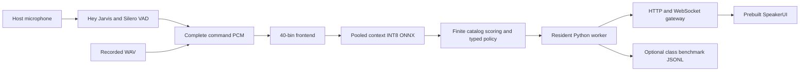

# PCV full benchmark v1

Status: full benchmark and serving software verified, 2026-10-02. Model
qualification remains failed; automatic acceptance remains disabled. Addresses ME-03,
ME-04, ME-06, ME-07, ME-08 and UC-01 through UC-10. Owner: current benchmark task.

## Design and implementation plan

Goal: deliver one reproducible benchmark package for the selected release-v1
architecture, its existing serving runtime, the current HF evaluation splits,
single-core PC measurements, and the same measurement script on Raspberry Pi.

Architecture: use the existing complete-utterance PooledContextVCM INT8 graph,
40-bin frontend, finite CTC catalog scoring and schema-v3 typed rejection policy.
Reuse the resident Python worker and compiled SpeakerUI gateway. No retraining,
threshold changes, test-driven catalog changes, model installation, physical
device operation, or repository maintenance is part of this benchmark version.
The disabled policy remains authoritative. An all-reject system cannot qualify.

Source: HF airimonda/ai231-me2-voice-commands at
6947f13073e57eb6ae67e7e2fc3680700b82aa13. Compare with training-bound revision
25111444af3adff7588d86ab27c304bb080895cf. External live benchmark:
airimonda/vcm-benchmark at 17d2dfe98f7dad4da3b5368082ecb47d2a4acd05.

Allowed changes: new benchmark source/runtime/tests, the publisher's explicit
runtime allowlist, an opt-in serving log adapter, this report, experiment summary,
and new experiments/pcv-full-benchmark-v1 receipts. Preserve all existing frozen
model/data receipts and unrelated dirty work. No commit or branch change.
Existing committed ignore rules cover .cache and dist; compact experiment JSON
and source remain visible. The ignore-first gate passed without rule changes.

- [x] Acquire every current evaluation parquet at the pinned revision, verify LFS
  hashes and row counts, preserve source metadata and split boundaries. Audit
  PCM identity against the selected model's fitting/dev/calibration manifests.
  Retain ambiguous references and metadata conflicts, with explicit denominators.
- [x] Add tested conversion from typed commands to the external 19-intent schema.
  Diagnostic candidates never appear as accepted predictions. Keep class-label
  scores separate from strict typed-output scores.
- [x] Add portable preloaded-PCM benchmark with single-CPU affinity set before
  numerical imports, one numerical/ORT thread, warmup and repeated observations,
  latency stages, RTF, CPU time, peak RSS, Pi temperature/throttling and identities.
  Missing/corrupt audio must fail rather than silently shrink the benchmark.
- [x] Run fresh full inference and serving smoke checks. Package using the existing
  model publisher, add the complete evaluation corpus and scripts, validate a clean
  extraction and preserve hashes, results and failed gates.

Review focus: repeated runs must not overwrite evidence; CPU affinity failure
must not be described as single-core; ambiguity must not become a negative;
duplicate audio must remain disclosed; a disabled policy must not be bypassed
by the adapter; desktop or parser evidence must not imply physical Pi results.

Ruling: extend the existing dirty checkout in explicit paths rather than create
a HEAD-only worktree, because the selected serving implementation and its bound
release artifacts are current uncommitted work. Preserve their source identities.

## Findings and verification

The benchmark has 6,768 original supplied recordings, including 1,612 reserved
supplemental tests and 261 reserved supplemental holdouts. The supplemental
Parquet filename says train, but its authoritative `voice_split` column is used:
all 3,983 supplemental training rows are excluded. The original 4,895-row manifest,
protocol and first PC run are preserved; the additive supplemental protocol and
expanded run have separate receipts. No test audio was used for fitting, threshold
selection, phrase additions, or choosing another model.

| Track | Recordings | Supported positives | Unsupported negatives | Ambiguous |
|---|---:|---:|---:|---:|
| Primary test | 4,443 | 4,203 | 139 | 101 |
| Primary holdout | 202 | 186 | 16 | 0 |
| Synthetic negatives test | 250 | 0 | 250 | 0 |
| Supplemental test voices | 1,612 | 1,612 | 0 | 0 |
| Supplemental holdout voices | 261 | 261 | 0 | 0 |

Primary dataset is the headline track; supplemental and synthetic-negative results
remain separate. Human/supplied-synthetic scores are diagnostic breakdowns. The
primary and supplemental holdouts are not pooled into test. All 101 ambiguous
metadata references remain visible, but do not become negative exact-command
references. Publisher-label metrics from the external scorer use its own complete
denominators and are reported separately from stricter typed-output references.

The PCM and declared speaker audits find no overlap with the selected model's
fitting, development, or calibration partitions. Existing test/holdout exposure
remains disclosed: 4,332 base recordings share PCM with earlier evaluation, and
supplemental voices already belong to their published evaluation splits. There is
one duplicate PCM group, retained in published row counts and explicitly indexed.
Labels were not independently listened to or corrected using model mistakes. The
combined corpus records only 93 of the 415 phrase definitions; other definitions
remain untested rather than inheriting baseline accuracy.

## Selected architecture and serving

The packaged graph is the existing development-selected `release-v1`
PooledContextVCM, SHA-256
`588f5f44f2b8bca9f68be605bc3a0be2be36159477c6002f21708824503c8421`.
It has 2,066,831 parameters, a 3,173,089-byte dynamic INT8 ONNX graph, six
bidirectional context blocks, width 192, four attention heads and feedforward
width 384. Its input is 40-bin log-mel at a 10 ms hop. Output stride is 20 ms.
Learned utterance pooling supplies intent and light-target heads; the acoustic
head scores a frozen 1,031-entry finite command catalog. There are 18 typed
runtime intents plus OOV, mapped to the class benchmark's 19 intents by splitting
volume up/down. There is no transcript decoder, LLM, cloud inference, teacher in
the package, or automatic fallback. This is complete-utterance inference after
endpoint detection, not the older causal CNN or a streaming acoustic encoder.



The wake head remains pretrained; project-trained wake quality is not established.
Wake/VAD models, licenses and metadata ship alongside the VCM. The authoritative
policy rejects because qualification failed. Raw and threshold-filtered candidates
are diagnostics, never actionable results. Device actions remain disabled.

Serving remains one resident CPU worker with one ONNX VCM session, the existing
Node gateway and prebuilt SpeakerUI. `PCV_BENCHMARK_LOG` enables a separate flushed
JSONL log with `intent`, `slot`, `infer_ms`, `audio_ms` and wake events understood
by airimonda/vcm-benchmark. Logs use authoritative acceptance only. Inference time
includes feature extraction, ONNX, finite decoding and policy; it is conservative
relative to the external feature-plus-model timing definition.

## External benchmark investigation

Reviewed the pinned [airimonda benchmark](https://github.com/airimonda/vcm-benchmark/tree/17d2dfe98f7dad4da3b5368082ecb47d2a4acd05)
loader, schema, slots, scorer, README and Pi agent. All 93 baseline typed commands
pass its actual intent/slot normalization. Its 93-way score is semantic
intent-plus-slot matching, not identification of which synonymous wording was
spoken. Its resource and response-latency measurements are useful for a separate
laptop-speaker-to-Pi-microphone test, including false wakes, endpoint delay and
transport. Simulation cannot establish acoustic performance.

The upstream loader resolves Hugging Face `main` and reuses an existing cache
without a revision/hash check. The README/card's stated 196 holdout rows are
outdated for the pinned 202-row source. Use the bundled
`benchmark/holdout/manifest.csv` with the external tool's `--holdout` option to
replay the exact packaged holdout. Upstream code is not vendored in the package;
its source hashes and scoring commit are retained in the evidence. This task did
not operate the external tool's speaker, microphone, SSH installer or Pi agent.

## Reproduction and Pi commands

From this checkout, use the root environment:

```powershell
.venv/Scripts/python.exe -m scripts.test.pcv_benchmark_source
.venv/Scripts/python.exe -m scripts.test.pcv_benchmark_supplemental
.venv/Scripts/python.exe -m scripts.runtime.pcv_full_benchmark --bundle .cache/pcv-release-train-v1/runs/release-v1/evaluation/bundle --manifest .cache/pcv-full-benchmark-v1/corpus/full-manifest.json --definitions .cache/pcv-full-benchmark-v1/corpus/definitions.json --output .cache/pcv-full-benchmark-v1/NEW-RUN --cpu 0
```

Use a new result directory for every measurement. The package contains all audio,
manifest hashes, models, frozen policy, runtime, expected phrases and evidence.
It needs no PyArrow, dataset library, training corpus or network during inference.
Dependency setup uses the existing pinned cross-platform `uv.lock`.

After extracting either final benchmark ZIP on a 64-bit Pi:

```sh
# First setup installs dependencies, then performs the full recorded benchmark.
python3 start.py --benchmark-only --cpu 0

# Subsequent offline measurements, with an explicit new output directory:
sh benchmark_pi.sh --output results/pi-single-core-01 --cpu 0

# On a PC, use the package environment directly:
# .venv/Scripts/python.exe benchmark.py --output results/pc-single-core-01 --cpu 0

# Pi UI serving; log authoritative outputs for the external live benchmark:
export PCV_BENCHMARK_LOG="$PWD/results/live-benchmark.jsonl"
python3 start.py --mode serve --benchmarks skip
```

The benchmark sets affinity to exactly one allowed logical CPU and one numerical
thread before NumPy/ORT imports. It fails if affinity cannot be verified. It does
not reserve the core exclusively, control frequency or disable SMT. Warmup, cold
load, first inference, all-corpus timing and repeated balanced timing samples are
separate. Repeated observations do not inflate accuracy denominators. The launcher
runs benchmarks in a child process so serving does not inherit CPU affinity.

Pi reports identify the device, OS, provider, threads, model and manifest hashes,
stage p50/p95/p99, RTF, CPU time, high-water RSS, temperature, CPU clock and throttling
where available. Null telemetry means unavailable, not zero. RSS includes Python,
catalog, corpus metadata and accumulated results, not just the neural model.
File loading, wake/VAD, speech duration, endpoint silence, UI and transport are
excluded from command inference timing. Physical Pi and live microphone remain
unmeasured until these scripts are run on the actual device.

This is a local class/research package. Preserve the source card and notices:
the supplied student recordings must not be shared outside the class without
speaker consent, and source-dependent research/education terms still apply.

## Fresh expanded-corpus results

The same selected graph and policy were replayed on all 6,768 recordings. Each
recording appears once in correctness metrics, independent of timing repetitions.

| Track | Raw exact positive commands | Frozen thresholds, diagnostic only | Raw errors on negatives | Threshold errors on negatives |
|---|---:|---:|---:|---:|
| Primary test | 4,054/4,203 (96.45%) | 3,365/4,203 (80.06%) | 101/139 | 1/139 |
| Primary holdout | 182/186 (97.85%) | 145/186 (77.96%) | 12/16 | 0/16 |
| Supplemental test | 1,587/1,612 (98.45%) | 1,400/1,612 (86.85%) | Unmeasured, no negatives | Unmeasured, no negatives |
| Supplemental holdout | 250/261 (95.79%) | 168/261 (64.37%) | Unmeasured, no negatives | Unmeasured, no negatives |
| Synthetic negatives test | No positives | No positives | 225/250 | 8/250 (3.2%) |

The actual disabled policy emits **zero accepted commands** on every track.
The threshold column is a hypothetical diagnostic replay of the unchanged frozen
thresholds, not an enabled runtime. Primary threshold precision is 3,365/3,377
(99.64%), but recall is below 90%; synthetic-negative false acceptance exceeds
1%. These are failed gates. Do not promote this model or report an all-reject
negative score as qualification.

Primary human raw exactness is 498/613 (81.24%); supplied-synthetic raw exactness
is 3,556/3,590 (99.05%). Those origin diagnostics explain why combined accuracy
alone is insufficient. The external scorer's publisher-label command accuracy is
93.52% on 4,443 primary test rows and 92.08% on 202 holdouts; its reference space
differs from the strict typed table above. Full macro metrics, Wilson intervals,
confusions and conditional slot distances are in the external scorer receipt.

On Windows / Intel Core i9-14900, process affinity was verified as logical CPU 0,
with one ORT intra-op/inter-op thread and one BLAS/OpenMP thread. This is a shared
workstation measurement: the core was not reserved and separate package/software
verification also ran during this interval. No Pi extrapolation is claimed.

| Timing/resource measurement | Value |
|---|---:|
| Warm complete inference, 6,768 rows, p50 / p95 / p99 | 41.07 / 104.63 / 118.37 ms |
| Frontend p50 / p95 | 0.95 / 2.04 ms |
| ONNX model p50 / p95 | 2.80 / 7.76 ms |
| Finite decoding and decision p50 / p95 | 37.34 / 95.41 ms |
| RTF p50 / p95 | 0.02327 / 0.02468 |
| 128 balanced recordings x 3 repeats, p50 / p95 | 38.32 / 117.58 ms |
| Model/session/catalog load | 90.08 ms |
| Cold first inference | 121.07 ms |
| Process high-water RSS after load / full run | 83.48 / 131.30 MiB |
| Inference CPU time / inference wall time | 94.40% of one logical processor |
| Full replay and timing repeats, including file reads/loop overhead | 331.69 s |

Decoding dominates latency. Further optimization should target the finite scorer
with parity checks before touching graph quality or calibrating different
catalog competition. The present inference is faster than real time on this PC;
that statement excludes capture and endpoint delay and does not establish Pi
performance.

Verification: 173 Python tests passed with seven expected historical-payload
skips and nine existing ONNX export warnings; 84 SpeakerUI tests passed;
Svelte/TypeScript checks and production builds passed. Fresh extracted-package
WAV/CLI/HTTP/WebSocket/frontend-adapter parity passed 15/15, including invalid
WAV, disabled mock and cross-origin rejection checks. The serving benchmark log
contains exactly 15 authoritative rejections with measured inference/audio times.
The first validation harness inherited the log environment into both its reference
CLI and server, causing 30 expected entries; the reference environment was isolated
and the test rerun. This was a harness issue, not a duplicate serving emission.

The extracted package validated all 6,768 audio hashes and ran 14 sampled WAVs
with training imports and the network connection helper blocked. This is a software
offline dependency probe, not an OS-level network-disabled or physical Pi test.
Code review found and fixed destructive scoring reruns and benchmark affinity
leaking into later serving; regression tests cover both resource boundaries and
supplemental voice filtering. Installed artifacts and model/policy hashes are
preserved. No training, model installation, commit, push or physical-device action
occurred.

Evidence: [full PC metrics](../experiments/pcv-full-benchmark-v1/pc-full-results.json),
[external scorer metrics](../experiments/pcv-full-benchmark-v1/pc-full-single-core-external-results.json),
[diagnostic thresholds](../experiments/pcv-full-benchmark-v1/pc-full-single-core-threshold-results.json),
[per-source metrics](../experiments/pcv-full-benchmark-v1/per-source-results.json),
[primary source audit](../experiments/pcv-full-benchmark-v1/source-audit.json),
[supplemental audit](../experiments/pcv-full-benchmark-v1/supplemental-audit.json),
[serving](../experiments/pcv-full-benchmark-v1/serving-results.json),
[extraction](../experiments/pcv-full-benchmark-v1/extraction-results.json).
Raw trials/timings are under `.cache/pcv-full-benchmark-v1/pc-full-single-core/`;
the complete trial JSONL is also included in each final benchmark ZIP.

Remaining release work: improve rejection and retained positive recall using a
new training/development protocol, with the newly exposed tests kept out of
selection. Audit any use of supplemental training by its voice_split and retain
the held-out voices. Additional human recordings/calibration coverage, the other
322 phrase definitions, trained wake evidence, and actual Pi/live-microphone
measurements remain required. The benchmark package is complete; a qualified
final model is not established by these results.
