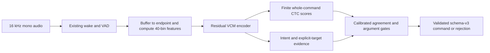

# PCV-B1 architecture and public-speech training plan

> For implementers: execute these tasks inline with the executing-plans skill. Keep this study separate from the active Parler v3 generation and every frozen PC-v1 study.

**Goal:** finalize a typed, extensible command interface and train a stronger direct VCM primarily on original public human speech, then measure whether synthetic slot coverage improves it.

**Current result:** training and the locked comparison are complete. Development selected the mixed model; it ranks all 93 SAPI baseline recordings correctly, but both acceptance policies fail calibration recall and remain disabled. Both trained ONNX exports pass numerical checks. The waveform-streaming frontend fails the strict numerical gate; the complete-utterance feature path passes a separate 24-probe check. The architecture and schema are finalized as a research baseline, not a qualified release. The separately versioned [three-engine extension](EXPERIMENT-pcv-b1-three-engine-v1.md) covers all 415 phrases.

**Architecture:** buffer 16 kHz audio until the endpoint, compute the existing 40-bin frontend once for the complete utterance, then use a residual causal acoustic encoder and exact whole-command CTC scoring against a finite catalog. Auxiliary intent and explicit-light-target heads provide additional rejection evidence. The decoder returns catalog command IDs and typed slots; it never generates an unconstrained transcript. Wake/VAD remain separate existing components. A model is replaceable together with its frontend statistics, catalog, calibration, state shapes and integrity manifest.

**Stack:** existing root Python environment, PyTorch for training, CPU ONNX Runtime for inference, NumPy/einops and the existing finite CTC decoder. No new environment, remote recognition service or device integration.

**Specification:** the user's 2026-10-01 baseline table and clarifications, together with [REQUIREMENTS.md](../REQUIREMENTS.md). This document records the new study; it does not revise an older frozen protocol.

## Scope and contract

The baseline has 93 cases: 39 fixed phrases plus 54 template/value combinations. It has 18 positive intent labels after merging VOLUME_UP and VOLUME_DOWN into VOLUME. PLAY_MUSIC accepts a song title with optional artist. VOLUME supports up/down/mute/set, with an integer percentage for set. LIGHT_ON and LIGHT_OFF remain separate labels, with an optional named light. BRIGHTNESS supports an integer percentage and optional light. An omitted light means all lights; an explicit unresolved name must never become all lights. CALL defaults to Home; Mom is separate. MESSAGE has empty slots and sends nothing. Reminder tasks are a finite editable vocabulary, initially Drink water, Study and Exercise. No reminder time is invented.

Public output version 3 uses `schema_version`, `accepted`, `command` and `reason`. `command` contains `intent` and `slots`. Rejection has no executable command. Low intent evidence produces `OOV`; a confidently identified command with an unresolved/invalid required argument produces `invalid_argument`. Rejection scores must be calibrated; a catalog match or a softmax value is not an empirical confidence guarantee.

The initial catalog contains the full user baseline, named-light and named-brightness forms, songs with optional artist, Home/Mom calls, volume mute/percent, and explicit malformed/unknown competitors. Stable entity IDs live in a separately versioned custom-slot file. Changes invalidate old calibration until tested with the complete competing catalog. Exact text fixtures test the contract, not speech accuracy.

### Ratified interface

| Intent | Typed slots and defaults |
| --- | --- |
| PLAY_MUSIC | Empty slots for generic playback; optional `song_id`, with optional `artist_id` only when a song is present |
| WEATHER, TIME, PAUSE, STOP, NEXT, LIST_REMINDERS | Empty slots |
| MESSAGE | Empty slots for the three baseline requests; no send action |
| LIGHT_ON, LIGHT_OFF | `light_id`; omitted name becomes `light.all`, explicit unresolved name rejects |
| VOLUME | `operation`: `up`, `down`, `mute` or `set`; only `set` requires integer `percent` in 0–100 |
| CALL | `contact_id`; omitted name becomes `contact.home`; Mom is `contact.mom` |
| TIMER | Integer `duration_seconds`; baseline values 10, 30 and 60 |
| ALARM | `time` in 24-hour `HH:MM` and benchmark `timezone` of `Asia/Manila` |
| TEMPERATURE | Integer `degrees` and benchmark `unit` of `C` |
| BRIGHTNESS | `light_id` and integer `percent` in 0–100; supports named-light adjust/set forms |
| COLOR | `light_id` and an enumerated lowercase `color`; red, blue and green are baseline values |
| CREATE_REMINDER | `task_id` from the configured vocabulary; no time is inferred |

Temperature units and alarm timezone are explicit benchmark configuration inherited by this version, not inferred from the speaker. Schema-valid ranges are wider than measured acoustic coverage. The finite catalog determines which complete spoken combinations can actually be recognized.

For example, “Set brightness of kitchen lamp to sixty percent” has the exact accepted response:

```json
{"schema_version":3,"accepted":true,"command":{"intent":"BRIGHTNESS","slots":{"light_id":"light.kitchen","percent":60}},"reason":null}
```

A confidently recognized lighting request with an unresolved name instead produces:

```json
{"schema_version":3,"accepted":false,"command":null,"reason":"invalid_argument"}
```

Low intent evidence produces the same rejection envelope with `reason: "OOV"`. `capture_fault` and `unqualified_model` describe operational rejection. The [machine schema](../experiments/pcv-human-slots-v1/output.schema.json) and [baseline cases](../experiments/pcv-human-slots-v1/baseline.json) are the reviewable contract. Deterministic expected JSON does not bypass the acoustic confidence gates.

## Candidate architecture and comparison

The legacy comparison is the original human-trained 113,064-parameter PC-v1 ONNX graph, hash `871c4a218684d50d132d8458b178e30c53ebff92c82b194bf3adaaa8652b1599`. It remains diagnostic: its existing nonzero-cache export parity error exceeds its frozen tolerance.

The new candidate uses width 128, ten depthwise residual temporal blocks (dilations 1,2,4,8,16 repeated twice), per-frame channel normalization, a 40-output CTC head, 19-way intent head (18 plus OOV), and a two-way explicit-light-target head. Its FP32 graph budget is 2 MiB; this is a new study budget, not a relaxation of an old release gate. Streaming caches and output heads are declared in the bundle rather than inferred from a fixed six-state layout. This architecture is a testable candidate, not a claim of optimality.



For the present baseline, retain mono PCM until the endpoint and compute the complete feature matrix once, with frozen training normalization. The neural encoder can process that matrix at once or in slices while retaining all 11 states and the finite decoder's accumulated scores. Sum intent/target logits and valid frame counts, then form one utterance mean; averaging chunk means without weighting would change the result. Reset every state between utterances and after a capture fault. This choice preserves the measured cached-feature path. Continuous PCM frontend streaming remains unqualified because its batch arithmetic changes low-order floating-point values. Wake/VAD timing and end-to-end integration still require their own replay and device evidence.

Model replacement is an atomic bundle change: ONNX graph, input/output names and 11 state shapes, frontend statistics, catalog, custom-slot registry, output schema, calibrated rejection policy and identity hashes travel together. Each new audio stream resets all states. The existing six-state delivery adapter cannot load this model unchanged; a compatible adapter and full stream/end-point parity are separate release work. This study produces research bundles and measurements, not a silent installed-model replacement. Catalog additions require fresh competition calibration; newly added textual names have no acoustic qualification until recordings test them.

The qualification1 compiler supports additive custom entries and aliases over the frozen inherited catalog. Renaming or removing an inherited entity requires a new catalog/dataset version with explicit label migration; changing the custom file cannot silently rewrite this benchmark. Arbitrary new names also need known pronunciation data or separately authorized enrollment, confusable unknown examples, and new acoustic evidence.

Current brightness enumeration includes every integer 0–100 for `light.all`, `light.kitchen` and `light.bedroom` through inherited and new forms. The new bathroom demonstration enumerates 0, 20, 60 and 100; the newly added adjust/set-of-name templates also use these four values. These are catalog counts, not acoustic accuracy. The next augmented version must expand each required name/template/value Cartesian product explicitly and recalibrate the enlarged competition. The typed schema permits 0–100 throughout, but a schema-valid value alone does not create a recognized complete utterance.

## Data and synthetic-speech investigation

Reuse local original FSC, SLURP-real and Speech Commands recordings and their pinned source receipts. Do not download duplicates. FSC retains its official speaker splits; validation speakers are separated into development and calibration. SLURP's current metadata shows substantial speaker overlap across its original splits (train/devel 135, train/test 136, devel/test 130). Assign its identified speakers deterministically to new train/dev/calibration/test splits and keep paired microphones together. Record exclusions, source labels, every audio/feature hash, exact phrase coverage and missing roles. Human-only means original audio, without TTS, splicing or synthetic transformations.

Do not force all source labels into the new ontology: use published text as acoustic supervision, and only conservative, auditable mappings for intent/complete-command supervision. Unsupported valid requests are identified separately from malformed commands. Test metadata may be used to construct the frozen benchmark before fitting, but test inference cannot select weights or thresholds. This is a new speaker split over previously studied public data, not a newly collected blind corpus.

Matched experiment: train a shared human-only acoustic foundation from random initialization; continue it for equal optimizer-step budgets with (A) human speech only and (B) 75% human/25% synthetic speech. Each mixed batch has 36 human, six existing Qwen and six SAPI examples. Freeze the seed, schedule, sample IDs, catalog and selection rule before fitting. The Parler corpus with a known codec-loading problem is excluded; its replacement is owned by another active study. Reusing Qwen does not certify its spoken text: generation labels remain unreviewed, and synthetic voice IDs are not human speakers. Assess human exact commands, OOV errors and covered synthetic names/numbers separately. Missing baseline phrases/tasks require fresh recordings or a separately versioned generation stage.

Research question: does bounded multi-voice synthetic augmentation improve exact finite slot commands without harming held-out human speech? Include primary direct-SLU augmentation papers and official dataset documentation; exclude ASR-only accuracy claims as evidence for this VCM. [Lugosch et al. (2019)](https://arxiv.org/html/1910.09463) found useful augmentation on FSC and Snips, especially with few real speakers, while real speech remained stronger and gains at higher real-speaker counts were uncertain. Their architectures and evaluation differ from this study; the paper motivates a matched comparison, not an expected score. [SLURP](https://github.com/pswietojanski/slurp) supplies semantic annotations and speaker/recording metadata; its automatic WER metadata is not independent listening. [FSC](https://fluent.ai/fr/fluent-speech-commands-a-dataset-for-spoken-language-understanding-research/) is an academic-research dataset; preserve that restriction. SLURP audio is CC BY-NC 4.0 according to the pinned local source receipt.

## Execution tasks and evidence

- [x] Contract: add `scripts/runtime/pcv_schema.py`, the 93-case baseline and custom slots under `experiments/pcv-human-slots-v1/`; verify defaults, exact types, invalid names, alias collisions, numeric boundaries and OOV outputs.
- [x] Candidate: add `scripts/models/pcv_residual.py`; test causal chunk/full equivalence, nonzero caches and CPU ONNX parity with dynamic frame counts. Count all heads and graph bytes. Trained export and waveform checks remain part of evaluation.
- [x] Data: add `scripts/train/pcv_public_data.py`; audit immutable public audio, freeze new manifests, write per-source/split/intent/role counts and baseline coverage. Split before fitting; reject cross-split speaker, paired-recording or PCM duplication.
- [x] Training: add `scripts/train/pcv_public_training.py` and a thin `scripts/pcv_public.py` entry point. Freeze source hashes and protocol; train real-only foundation and equal-budget continuation arms. Save resumable optimizer/RNG state and development selection receipts.
- [x] Evaluation: qualification1 calibrated on reserved data, bound policies before test, then evaluated all 11,363 held-out recordings once per arm. Raw, accepted, per-source/intent/slot/phrase and rejection evidence are retained. Both quality gates failed; all-reject is not baseline acceptance.
- [x] Parent handoff: this findings log and EXPERIMENTS.md preserve results and numerical failures. The additional three-engine benchmark is its own test version. No installation, physical Pi action, commit or push is part of this study.

Review focus: unknown named lights must not fall back to all; numeric booleans are invalid; equal aliases with conflicting commands must reject; new model caches must remain correct across chunk boundaries; shared or paired recordings must not leak across splits. Add a targeted test for each boundary.

## Findings log

2026-10-01: The preceding baseline dummy run passed 235 software tests and 21 ONNX/file/transport/package robustness checks. All 20 installed artifacts were unchanged. The old graph's nonzero-cache error reproduced at 0.000026702880859375 against its 0.00002 bound. This is diagnostic software evidence only. See [machine receipt](../experiments/pcv-delivery-v1/verification-baseline-dummy-20261001.json).

2026-10-01: Prepared 67,386 unique usable recordings: 49,536 original human (30,041 FSC, 16,995 SLURP-real, 2,500 Speech Commands) and 17,850 explicitly synthetic (16,608 existing Qwen and 1,242 new SAPI). The SAPI probe covers 414 phrases, including every baseline case, using David for training, Mark for development and Zira for testing. Duplicate Desktop variants of the same voices are not counted as new speakers. No Parler data enters this study. Local SAPI generation uses no GPU and does not interrupt the active Parler job.

The frozen splits contain 42,039 training, 6,784 development, 7,200 calibration and 11,363 test recordings, with zero cross-split speaker, paired-recording or PCM overlap. 54,321 SLURP references have no local audio and are explicitly excluded; missing dictionary entries, one excessive-duration recording and one same-split duplicate are also recorded. The catalog has 3,151 complete positive/negative hypotheses; it does not infer arbitrary unseen text. [Data audit](../experiments/pcv-human-slots-v1/data-audit.json), [freeze](../experiments/pcv-human-slots-v1/data-freeze.json), and [93 typed baseline cases](../experiments/pcv-human-slots-v1/baseline.json).

The new candidate has 366,653 parameters, including auxiliary heads, and 31,824 cached floats. Full-size untrained export is 1,516,567 bytes and passes raw-logit/nonzero-cache parity at maximum absolute error 0.00000166893, below 0.00002. The use of residual separable convolutions is motivated by compact command architectures such as [MatchboxNet](https://arxiv.org/abs/2004.08531); this causal CTC/auxiliary-head model is a different implementation, not a reproduction of its reported accuracy.

Twenty-two software checks now pass, including schema, padding, streaming state, numerical export, split leakage, all-reject failure, registry updates, exact per-intent precision and ambiguous-target rejection. These are not speech scores. The 24-epoch human foundation and both 12-epoch continuations completed, totaling 36,096 optimizer updates. The foundation selected epoch 12 with 117/120 exact supported human development commands before rejection, with substantial raw negative candidate errors still requiring policy calibration. Do not interpret that as accepted precision.

The predeclared development rule selected human-only epoch 4 and mixed epoch 8. Both have 114/120 raw exact human positives; synthetic positives improve from 145/176 to 175/176 with augmentation. Raw negative candidate errors are 100/150 human and 3/12 synthetic for the human-only model, versus 97/150 human and 0/12 synthetic for the mixed model. Development therefore selects the mixed arm before any calibration/test inference. These are small stratified development samples, not final quality estimates. [Training completion](../experiments/pcv-human-slots-v1/training-completion.json), [selection before test](../experiments/pcv-human-slots-v1/selection-before-test.json).

### Qualification revision after independent review

The independent review found no training-stopping defect. It identified three missing positive calibration intents (MESSAGE, LIST_REMINDERS, CREATE_REMINDER), unenforced evaluation file identities, an incorrect reference-only denominator for per-intent precision, and disagreement between the generated custom-slot snapshot and imported legacy IDs. A targeted test also showed that an uncertain explicit-light target could default to all. Frozen training files and labels are preserved. The parent `scripts/pcv_public.py evaluate` path is retained as historical code and **must not be used for authoritative qualification**.

The versioned [qualification1 protocol](../experiments/pcv-human-slots-v1-qualification1/protocol.json) fixes evaluation before any test inference. It adds only reserved-voice Qwen calibration recordings, keeps train/development/test membership unchanged, validates every bound input and inference feature/audio, computes precision over all predictions of each intent, and uses an authoritative [custom-slot file](../experiments/pcv-human-slots-v1-qualification1/custom-slots.json). Legacy IDs remain explicitly registered without relabeling old samples. The configured Mom alias `mother` adds one competing hypothesis; both candidates will use the same new catalog and new calibration. The light-target gate now rejects uncertain presence rather than applying the all-lights default.

Qualification compares both original-human and synthetic strata against 99% precision, 90% recall and at most 1% negative false accepts. A failed policy remains disabled; raw ranking results are reported separately. Calibration/test do not choose training weights. A single SAPI test voice does not meet the earlier multi-engine baseline evidence requirement, even if every phrase ranks correctly. [Review and test receipt](../experiments/pcv-human-slots-v1-qualification1/review-resolution.json).

Run the child using the root environment: `python experiments/pcv-human-slots-v1-qualification1/run.py generate`, then `python experiments/pcv-human-slots-v1-qualification1/evaluate_parallel.py evaluate`. Generation waits for parent fitting to finish to avoid competing GPU-memory allocations. All speech output is written to files; no microphones or device actions are involved.

The execution-only parallel wrapper is separately bound and verified before test. On 240 predetermined development recordings, all saved scores, margins, intent/target probabilities and commands match exactly between six and twelve workers. Observed elapsed time falls from 15.50 to 10.71 seconds including worker startup, so final evaluation uses twelve workers with unchanged inference, thresholds and selection. [Execution proof](../experiments/pcv-human-slots-v1-qualification1/execution-proof.json). Trained preflight exports pass the original 0.00002 bound: human-only maximum error 0.0000133514; mixed 0.0000190735. Both FP32 graphs are 1,535,007 bytes. These are CPU numerical results; the accuracy test and full waveform streaming check remain separate.

The calibration extension completed all 415 recordings with no failed generation attempts or duplicate exclusions. The combined calibration set has 7,615 recordings: 2,851 finite positives and 4,764 negatives, with positives for all 18 intents. Only the reserved `qwen/cal-us-f` voice was used. These are waveform/hash checks, not independent verification that every generated utterance matches its prompt. [Calibration freeze](../experiments/pcv-human-slots-v1-qualification1/calibration-freeze.json), [coverage](../experiments/pcv-human-slots-v1-qualification1/calibration-coverage.json). Before acoustic evaluation, all 18,978 calibration/test audio and feature identities and every frozen parent/child binding were verified. The human-only and mixed models use identical manifests and the 3,152-entry child catalog.

The augmentation literature also supports keeping this a measured comparison: [Cheng and Zou, IJCAI 2024](https://www.ijcai.org/proceedings/2024/0689.pdf) report benefits from filtering generated audio and preserving the role of real speech during training. Their HuBERT-based textless SLU system is much larger and differs from this finite VCM. We use the finding to motivate source separation and quality checks, not to predict a score or substitute generated labels for independent listening.

### Completed locked comparison

Both arms used the same 11,363 test recordings, the same 3,152-entry catalog and independently calibration-locked policies. The test did not select weights, thresholds or the winner. [Comparison](../experiments/pcv-human-slots-v1-qualification1/comparison.json), [human-only details](../experiments/pcv-human-slots-v1-qualification1/results-human.json), [mixed details](../experiments/pcv-human-slots-v1-qualification1/results-mixed.json).

| Measured raw exact commands | Human-only | Mixed |
| --- | ---: | ---: |
| Original human positives | 1,768/1,790 (98.77%) | 1,770/1,790 (98.88%) |
| Synthetic positives | 908/3,714 (24.45%) | 3,409/3,714 (91.79%) |
| FSC positives | 1,740/1,760 | 1,742/1,760 |
| SLURP-real positives | 23/25 | 23/25 |
| Speech Commands mapped positives | 5/5 | 5/5 |
| Qwen positives | 555/3,314 | 3,030/3,314 |
| SAPI positives | 353/400 | 379/400 |
| SAPI prescribed baseline | 91/93 | 93/93 |

The SAPI human-only errors are `B1-013` ("Lights out" ranked LIGHT_ON) and `B1-056` ("Set an alarm for 8:00 AM" ranked no command). The mixed model corrects both. This is one synthetic test voice; only 21/93 exact baseline phrases have any original-human corpus coverage, and the strong human aggregate is dominated by FSC.

Raw negative candidate errors remain severe on the original-human unsupported set: 2,629/3,623 for human-only and 2,639/3,623 for mixed. These include legitimate requests outside the finite contract, not just noise or nonsense. Synthetic negative errors improve from 396/2,236 to 34/2,236. Raw ranking is therefore unsuitable as an acceptance rule.

Neither arm reaches 90% recall while meeting 99% precision and at most 1% false accepts on both calibration strata. The mixed arm's best precision-safe calibration point has 249/793 human and 652/2,058 synthetic exact commands. Its locked test diagnostic point has 1,160/1,790 human and 732/3,714 synthetic exact commands, with 14 incorrect accepted synthetic commands (732/746 precision, 98.12%). Both actual policies are disabled and reject every test input with `unqualified_model`; zero accepted errors does not make that a passing recognizer. Do not activate the diagnostic point or reinterpret raw score as calibrated confidence.

Conclusion for this matched run: the finite residual model is trainable, and adding Qwen/SAPI improves covered synthetic slot recognition substantially without a measured loss on this narrow human positive set. General acceptance, broad original-human slot coverage and independence from the training synthesizers remain unresolved. The next version should expand adjudicated human names/numbers and confusable negatives, explicitly enumerate each template/name/value product, and evaluate calibration/auxiliary-head agreement on development data before a new locked test. This test's errors must not be used to tune the existing model or policy.

### Numerical runtime decision

Trained random-cache ONNX parity passes for both graphs (human maximum 0.0000133514; mixed 0.0000190735, bound 0.00002). Each graph is 1,535,007 bytes, with 366,653 parameters and 31,824 cached floats. This is the FP32 baseline; no quantized candidate is qualified.

The separate twelve-waveform streaming check fails: only 3/12 human-model and 2/12 mixed-model probes meet every strict bound. Maximum head differences are 0.0000572205 and 0.0000419617. All 24 raw command decisions nevertheless match. [Preserved failed receipt](../experiments/pcv-human-slots-v1-qualification1/bundle-check-results.json).

An isolated development probe shows identical neural outputs and final states when both paths receive identical feature values, across ALL, EXTENDED, BASIC and DISABLED ONNX optimizations and a prepacking-disabled control. Recomputing features from separate PCM chunks introduces differences of only a few times 10^-7, which the auxiliary heads amplify beyond the strict bound. This supports frontend batching as the numerical source; it does not isolate FFT versus matrix multiplication. No frozen frontend, tolerance or model was changed. [Diagnosis](../experiments/pcv-human-slots-v1-qualification1/stream-numerics-diagnosis.json). Optimization controls follow the [ONNX Runtime documentation](https://onnxruntime.ai/docs/performance/model-optimizations/graph-optimizations.html).

The endpoint-buffered path passes all 24 fixed development probes: whole-utterance waveform features match stored evaluation features, and feeding the identical matrix in seven-frame neural chunks matches full inference within the original 0.00002 bound, including complete commands. [Endpoint receipt](../experiments/pcv-human-slots-v1-qualification1/endpoint-check-results.json). Timings in the receipts are desktop CPU processing only, excluding disk, recording duration, wake/VAD and endpoint delay; no Pi latency or live microphone claim follows.

The held-out original-human positive set covers only 8/18 intents: LIGHT_OFF 361/366, LIGHT_ON 463/473, PAUSE 59/59, PLAY_MUSIC 87/89, STOP 53/53, TIME 1/2, VOLUME 745/747 and WEATHER 1/1 for the mixed model. ALARM, BRIGHTNESS, CALL, COLOR, CREATE_REMINDER, LIST_REMINDERS, MESSAGE, NEXT, TEMPERATURE and TIMER each have zero original-human positives in this test. Their reported accuracy comes from synthetic recordings, not human validation. These zero cells are required targets for the next dataset version. The diagnostic threshold point accepts only 21/93 SAPI baseline commands exactly (human-only 13/93), despite the mixed model's 93/93 raw rank accuracy. The actual disabled policy accepts none.

On the twelve endpoint development probes, mixed-model feature/ONNX/catalog processing has median 241.02 ms and p95 454.19 ms; human-only is 228.43 ms and 476.72 ms. This is a small desktop workload under concurrent synthesis, excluding disk, recording, wake/VAD and endpoint delay. [Compact timing receipt](../experiments/pcv-human-slots-v1-qualification1/desktop-endpoint-summary.json).

The paired positive-recording comparison strengthens the limited augmentation finding: mixed training corrects 2,504 synthetic errors from human-only and introduces three, with 905 correct and 302 wrong under both. On original-human positives it corrects eight and introduces six, with 1,762 correct and fourteen wrong under both. Thus human performance is approximately maintained; this single matched continuation pair does not establish a statistically reliable human improvement. [Paired receipt](../experiments/pcv-human-slots-v1-qualification1/paired-comparison.json).
