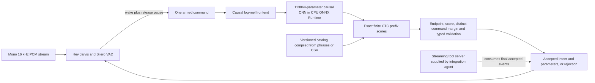

# PCV model, computations and deployment rationale

Status, 2026-10-01: implementation and synthetic data generation are in progress. There is no final v2 acoustic accuracy result, qualified model ZIP, or physical Pi measurement yet. An artificial-model diagnostic archive has passed a clean-extraction CPU loading test. Do not substitute that fixture for the selected trained model. Follow [the experiment report](EXPERIMENT-pcv-synthetic-v2.md), [delivery plan](PCV-DELIVERY-PLAN.md), [35-command demo](PCV-DEMO-COMMANDS.md), and [streaming integration contract](PCV-TOOL-SERVER.md).

## What the system computes

The VCM jointly chooses an intent and all required finite parameters from audio. It emits typed JSON or rejection. It never emits a transcript for another parser, searches arbitrary text recognized from speech, calls an LLM, or executes a device action. The phone inventory is an acoustic scoring basis for complete finite command hypotheses; there is no unconstrained phoneme-to-text decoder or fallback recognizer.

The wake gate and command recognizer solve different problems. A wake event arms one command; it does not authorize an action. The command engine must still reach a real endpoint and pass its calibrated policy. After one command or a capture fault, activation resets.

## Audio, wake and endpoint computations

Input is mono 16 kHz PCM. The service transport uses signed little-endian PCM16 and converts samples to float32 by dividing by 32,768. The normal chunk is 640 samples (40 ms); the maximum is 1,600 samples (100 ms). A sequence number is the absolute first-sample index, beginning at zero. Missing, repeated, out-of-order or malformed chunks cause rejection and reset, preventing a stale partial command from being acted upon.

The frozen Hey Jarvis adapter accumulates 1,280-sample/80 ms blocks, clips to [-1,1], scales to int16, retains 1,760 recent samples, and applies the installed wake mel graph. Its mel output is scaled by `/10 + 2`, appended to 76 x 32 feature history, and fed to the embedding graph. The adapter retains sixteen 96-component embeddings and scores them with the Hey Jarvis head. These shapes/scaling are the installed pretrained model interface, not newly learned VCM parameters. Startup scores are suppressed until sixteen real feature steps (1.28 seconds). The frontend should start streaming silence/context before inviting a wake phrase.

Silero receives 512 new samples every 32 ms, preceded by 64 retained context samples, and maintains its 2 x 1 x 128 recurrent state. Speech probability at least 0.5 within the most recent ten frames accompanies a wake score at least 0.5. Following detection, probability below 0.35 must persist for 320 ms before command-ready. The gap separates the wake phrase from the command; without a release within three seconds the gate rejects. Waiting more than five seconds for command speech also rejects. A four-frame/128 ms preroll protects the beginning of the command after command-ready. No command model inference is performed before activation.

The command endpoint is the study's causal energy endpoint, not a second transcription model. It processes 320-sample/20 ms frames, computing `RMS = sqrt(mean(x^2))`. The configured RMS threshold marks activity; at least 300 ms of active frames and then 700 ms of trailing silence are required to finish. A 12-second limit rejects instead of silently truncating a command. These times are frozen, so an optimized transport cannot remove the 700 ms endpoint wait from the reported user turnaround time. File EOF alone does not authorize acceptance.

The CLI and synthetic wake benchmark use the same replay helper: two seconds of detector warmup silence, the unchanged source waveform, then six seconds of timeout flushing. These are explicit stream context intervals, not spliced speech or part of the original recording. Live streaming has no artificial padding; real incoming samples advance detector and timeout state.

## Causal frontend

For each frame, take 400 samples (25 ms) with a 160-sample hop (10 ms). Multiply by the periodic Hann window `w[n] = 0.5 - 0.5 cos(2*pi*n/400)`, then compute the unnormalized 512-point real FFT. Power is the squared complex magnitude at 257 nonnegative-frequency bins.

Map frequencies to HTK mel units, `m(f) = 2595 log10(1 + f/700)`, and construct forty triangular filters between 20 and 7,600 Hz. Forty-two mel-spaced edge points define the triangles. For filter k, each frequency-bin weight is the nonnegative minimum of the rising and falling linear slopes. Multiply the power vector by this filter bank, clamp each result below at `1e-8`, and take the natural logarithm.

Normalize each mel channel with `(log_energy - training_mean) / training_std`. Mean and variance use only training frames; standard deviation is `sqrt(max(E[x^2]-E[x]^2, 1e-4))`. Development/test voices do not fit these statistics. There is no per-utterance normalization, centered window or future context. The streaming frontend retains unconsumed overlap and emits a frame only when all 400 samples have arrived.

Why: 40 bands and a 10 ms hop keep the input small while retaining spectral and temporal information for connected numbers/names. Log compression limits energy scale. Fixed training statistics allow the exact same computation in file, live and ONNX paths. No future context is required, making incremental execution possible. These are design choices being evaluated, not a claim that forty bands or this frontend is globally optimal.

## Neural layers and ONNX state

The model is a conventional dense temporal CNN with six causal convolution/ReLU layers and one linear projection. It is not depthwise separable and has no attention, recurrent neural state, pooling or downsampling. `B=1` at deployment. Input is `[B,40,T]`; exported logits are `[B,T,40]`. Each convolution preserves T by prepending its retained input history rather than padding with future samples.

| Layer | Input/output channels | Kernel | Dilation | Weights + biases | Cached input shape | Accumulated receptive field |
| --- | --- | ---: | ---: | ---: | --- | ---: |
| Stem + ReLU | 40 -> 64 | 3 | 1 | 7,680 + 64 = 7,744 | [1,40,2] | 3 frames |
| Conv1 + ReLU | 64 -> 64 | 5 | 1 | 20,480 + 64 = 20,544 | [1,64,4] | 7 frames |
| Conv2 + ReLU | 64 -> 64 | 5 | 2 | 20,480 + 64 = 20,544 | [1,64,8] | 15 frames |
| Conv3 + ReLU | 64 -> 64 | 5 | 4 | 20,480 + 64 = 20,544 | [1,64,16] | 31 frames |
| Conv4 + ReLU | 64 -> 64 | 5 | 8 | 20,480 + 64 = 20,544 | [1,64,32] | 63 frames |
| Conv5 + ReLU | 64 -> 64 | 5 | 16 | 20,480 + 64 = 20,544 | [1,64,64] | 127 frames |
| Linear projection | 64 -> 40 | 1 | 1 | 2,560 + 40 = 2,600 | none | 127 frames |

At each layer, concatenate the saved input state with the new layer input, retain the last `(kernel-1)*dilation` input frames for the next call, apply convolution and bias, then `max(0,x)` except at the projection. This keeps chunked computation equivalent to a full causal pass. The six caches contain 8,016 float32 values, or 32,064 bytes. Reset all six at utterance boundaries and model changes.

Total learned parameters: **113,064**. Raw float32 parameter storage is 452,256 bytes before ONNX metadata. The convolution/projection weights require 112,640 multiply-accumulates per frame, approximately 11.264 million per audio second at 100 frames/second, excluding frontend, activations, wake/VAD and catalog search. This is an operation count, not a measured Pi runtime. The 127-frame receptive field covers 1.285 seconds of waveform including the 25 ms analysis window. Dilations expand past context without storing or recomputing a long recurrent history.

The graph has inputs `features, state_0, ..., state_5` and outputs `ctc, next_state_0, ..., next_state_5`. FP32 and ONNX opset 17 are retained for reproducible parity. Export tests nonzero caches at 1, 3, 4, 8 and 17 frames and requires maximum absolute error below `2e-5`. The study also checks all development waveforms and final decisions before calibration. A small graph that fails numerical or waveform parity is not publishable merely because it loads.

Why keep this architecture: it permits controlled continuation from the real-data model, explicit state, simple CPU operations and a graph below 1 MiB. Adding capacity before measuring failures would confound the data/curriculum change. Quantization, pruning or a different encoder would require their own numerical, quality and target-device comparison; this delivery does not silently assume their benefit.

## Finite CTC search and typed decisions

The projection produces 39 phone logits plus blank for each frame. The decoder applies one stable log-softmax, subtracting the row maximum before exponentiating. It uses float64 log probabilities for accumulated finite-path scores; the neural graph and caches remain float32.

Every allowed/rejection phrase has a pronunciation sequence and a complete typed command or null. Sequences share prefix-tree nodes. Each node retains blank-ending and nonblank-ending log probability. At each frame:

- Blank state: `logaddexp(previous_blank, previous_nonblank) + logp(blank)`.
- Incoming nonblank transition: the parent's blank state, plus its nonblank state only when parent and child phones differ. This handles repeated labels without collapsing them incorrectly.
- Nonblank state: `logaddexp(previous_nonblank_at_node, incoming_parent) + logp(node_phone)`.
- Root nonblank remains impossible. A phrase's terminal score is `logaddexp(blank, nonblank) / processed_frames`.

No beam pruning approximates this calculation. The current full v2 catalog contains 2,768 phrase entries sharing 30,424 prefix nodes. Cost grows with nodes and frames; a small neural graph alone does not guarantee fast search. The deployment compiler caps inventory at 128 rows, four aliases per row, 4,096 entries and 60,000 nodes. These are resource guards, not proven maximum Pi capacity.

Rank phrase scores, then compare the best command against the highest-scoring **different full JSON command**. Aliases of the same command do not compete in the margin. Null hypotheses represent known rejections. Accept only after a valid endpoint, with an enabled identity-bound policy, a non-null command, finite score/margin, positive margin and both calibrated limits met. Otherwise return explicit rejection. Values remain typed: brightness integer 1 is distinct from boolean true, float 1.0 or string "1".

The model jointly selects parameters from the finite command; no text parser creates missing parameters afterward. The current contract includes brightness 0-100, named colors, target IDs, K-pop track IDs with optional artists, timer durations and finite clock/reminder/contact/message values. See the exhaustive [v2 verbatim guide](PCV-SYNTHETIC-V2-VERBATIMS.md) for the actual boundary. Reminder clocks currently enumerate hours and half-hours with AM/PM; other times and free-form content are not established support.

## Real baseline, synthetic continuation and evaluation

The continuation checkpoint is the project-trained semifinal seed 71, epoch 18 model. Its original protocol records 25,132 training examples from original FSC commands plus Speech Commands isolated negatives, random initialization and no pretrained neural weights. Preserve those recordings, manifests, original labels and historical failures. This foundation is a comparator, not proof that the final synthetic model generalizes to humans. Its historical export had a strict parity failure; the new candidate requires fresh export/parity.

V2 uses Qwen3-TTS 1.7B, Parler Large 2.2B and a reduced Dia 1.6B subset. There are 33,816 command recordings and 288 continuous wake recordings planned. Six synthetic voice groups are assigned to train, development, calibration and test; these are not six independent human speakers. Requested accents and exact spoken-text fidelity are not independently listener-verified. Audio hashes, decoded PCM, source model/recipe identities, duplicates and cross-split identities are audited.

Each of two continuation seeds trains forty epochs with batch size 64, AdamW learning rate 0.001, weight decay 0.0001 and gradient norm limit 5.0. CTC loss uses the full reference phone sequence and true feature length, excluding padded frames. There is no synthetic audio augmentation in this study. Sampling gives 80% mass to supported positives and 20% to negatives, balancing use case, phrase and speaker within those roles. It does not let many brightness values dominate the other use cases.

Development checkpoints are evaluated every four epochs. Selection orders candidates by phrases passing, worst use case, macro exact score and total correct, then deterministic seed/epoch tie breaks. The baseline is evaluated on the same development corpus/catalog with its own fitted normalization. Calibration is separate; test never selects weights, thresholds, wording or catalogs. Full phase/engine/use-case gates require at least 99% accepted precision, 90% exact accepted recall and at most 1% negative false accepts, with complete coverage and no critical false accepts or invalid trials. Wake-only misses, false wakes and capture faults also fail wake qualification. An all-reject policy cannot pass.

The 35-command demo was selected before fitting/test by semantic coverage, not observed successes. Its declared profile requires every selected exact phrase correct on both test voices of Qwen and Parler, with available Dia observations also counted, and retains the broad benchmark's failures. The separate full list of mistakes will include verbatim, expected JSON, raw parsed intent/candidate, accepted output, reason, source and audio identity. It is not hidden by a curated demo.

## Dynamic inventories

The acoustic output dimension is fixed at forty and does not depend on the number of songs or devices. A CSV inventory can therefore generate new finite hypotheses without changing the output layer. That structural capability is implemented; reliable recognition of previously unseen names is still an empirical question.

The compiler accepts `kind,id,name,artist,aliases,capabilities`. Fields use ordinary quoted CSV; aliases/capabilities within their column use `|`. Supported kinds are song, playlist and light. Stable IDs become output parameters. Duplicate song titles get a rejecting title-only form and distinct artist-qualified forms. Missing pronunciations, conflicting phonetic hypotheses, duplicate IDs, unsupported capabilities and budget overruns fail compilation. Adding words requires a versioned text pronunciation dictionary; there is no neural transcription fallback. An API adapter may produce this CSV later, but this package does not call Spotify or Home Assistant.

Changed catalog competition invalidates score/margin calibration. The compiler labels its output `requires_calibration=true`; deployment requires a newly validated bundle. Evaluate known names, unseen names, near-homophones, wrong artists and unknown targets on reserved recordings, recalibrate using development/calibration only, and fine-tune only if those measurements justify it. Reusing the real acoustic baseline is preferable to retraining the encoder for every inventory edit, but text-only updates do not inherit accuracy claims. Dynamic acoustic qualification and the CSV-to-calibration workflow remain unfinished delivery work.

## CPU deployment, swapping and resource accounting

The target is Raspberry Pi 4 with a 64-bit ARM64 Linux userspace and CPython 3.12. Runtime wheels are hash-locked for that target. The portable archive contains only required inference code, the selected graph, four wake/VAD graphs, catalog/policy/settings, notices, setup/serve scripts and runtime wheels. It excludes PyTorch, TTS generators, datasets and training code. The setup script requires CPython 3.12 and OS `libsndfile1`/`libportaudio2`, creates a local venv and installs the bundled wheels offline with hash verification. Model recognition makes no network inference calls.

Every ONNX session explicitly uses `CPUExecutionProvider`, one intra-op and one inter-op thread, sequential execution; deployment disables spinning. BLAS/OpenMP environment limits are set before importing NumPy/ORT. The service permits one active audio stream. Loading a replacement validates hashes, graph interface, catalog, policy, evidence and a small CPU execution probe before activation. The active stream retains its old bundle; subsequent streams get the new one. A failed replacement leaves the current bundle available. Rollback retains the preceding bundle in memory. Persistent restart selection remains the explicitly supplied `--bundle` path.

Activation ONNX bytes from the current installed assets: mel 1,087,958; embedding 1,326,578; Hey Jarvis head 1,271,370; Silero VAD 2,327,524. Include these 6,013,430 bytes, the VCM graph, catalog, Python/ORT dependencies, active/replacement sessions and decoder temporaries in footprint reporting. The 113,064-parameter count applies only to the command CNN.

CPU benchmarks must report source duration, load time, frontend/encoder/decoder/endpoint cost, p50/p95 processing and real-time factor, peak RSS, graph/catalog bytes, node count, hardware/OS/thread profile and end-of-speech-to-result latency. Desktop results are not Pi measurements. The CLI benchmark includes the explicit replay warmup/flush computation and excludes file reads; user speaking duration and the 700 ms endpoint wait are separate. A real-time factor below one on the named Pi and acceptable measured tail latency remain target evidence to collect.

## Export, publication and simulator

From the repository root, the export script is `python scripts/pcv_delivery.py export --training .cache/pcv-synthetic-v2/training --output <new-export-directory>`. The current orchestrator already performs export, full waveform parity and calibration; do not duplicate its executing stages. After measured results exist, `report` writes the predeclared demo results and mistakes; `assemble-bundle` validates the measured candidate and creates portable state; root `publish.py --pcv-runtime` builds the ARM64 ZIP. It refuses normal publication unless the broad, wake and demo gates pass. Diagnostic publication requires explicitly disabled acceptance and carries no qualification claim.

Before publishing an enabled ZIP, compare the assembled portable runtime with the study runtime using `python scripts/pcv_portable_parity.py --source .cache/pcv-synthetic-v2/calibration/bundle --portable <portable-bundle> --output <new-parity-directory>`. This replays all 5,636 development command recordings and 132 wake-path trials (72 continuous wake recordings plus 60 command-only no-wake trials). It never replays sealed test audio or changes thresholds. File/PCM hashes, identical graph/catalog/normalization/endpoint assets, unchanged acceptance thresholds and the source/deployment bindings are checked first. Command decisions, exact typed parameters, endpoint sample indices and ordered wake events must agree; finite score/margin and wake-score differences must be at most 2e-5. Computation time is recorded but is not an equality requirement.

The comparison writes per-recording outputs and preserves mismatches or partial failure receipts. Pass its `results.json` to `python publish.py --pcv-runtime --bundle <portable-bundle> --portable-parity <new-parity-directory>/results.json --output dist/pcv-rpi4.zip`. Publication rechecks complete coverage, saved output comparisons and current adapter source hashes, then includes the compact receipt in the ZIP. A matching all-reject replay demonstrates parity only; the separately required broad/wake/demo accuracy gates still prevent qualification. Actual selected-model portable parity is pending the running study, and desktop parity is not physical Pi performance.

The parity receipt compares wake-event order and content, but does not stamp each wake event with its emission sample position. It therefore does not establish identical causal wake-event timing. Command endpoint sample positions are compared; wall-clock timing and target-device latency remain separate benchmarks.

The existing `visualizer/` shows waveform, mel features, cached neural activations, layer computation and finite candidate scores. `visualizer/export_assets.py --pcv-runtime --bundle <portable-bundle> --checkpoint <selected.pt> --output <new-assets> --evidence <demo-results.json>` exports the actual weights after a nonzero-cache ONNX comparison. Saved results must match both source and deployment bindings and a recipe-bound file hash; another model cannot display them. Empty waveform collections initialize without a fabricated sample. Browser inference remains diagnostic, separately from recorded ONNX acceptance. Final selected-model assets, measured evidence and selected-model browser parity await the actual study results.

The historical human regression protocol is frozen in `experiments/pcv-delivery-v1/human-regression.json`: 3,993 test recordings (3,793 FSC and 200 Speech Commands negatives), the original 189-form catalog, matched endpoint/chunk settings and each model's own training normalization. Run `python scripts/pcv_human_regression.py --candidate .cache/pcv-synthetic-v2/calibration/bundle --output .cache/pcv-delivery-v1/human-regression` once the candidate exists. It reports raw typed-command correctness, negative candidates, endpoint faults and timing; acceptance stays disabled. This historical regression cannot select weights or thresholds and does not establish new human confirmation.
