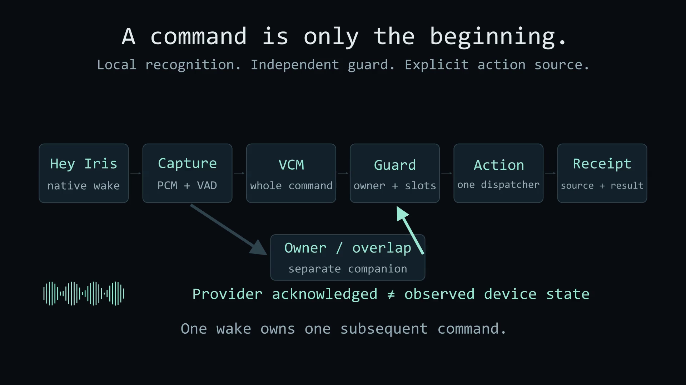
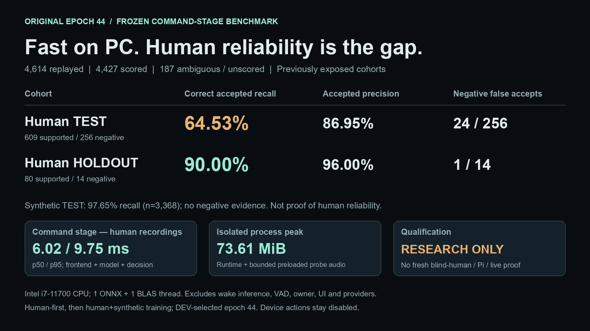

# OptionB Tiny epoch 44 — two-minute presentation

This is the presentation for the **original Tiny epoch 44**, not the GPU epoch 28 retraining or the older 2M presentation.

- Repository: [justinruaya123/smart-speaker](https://github.com/justinruaya123/smart-speaker).
- Frozen model release: [optionb-tiny-v1.0.0-rc.1](https://github.com/justinruaya123/smart-speaker/releases/tag/optionb-tiny-v1.0.0-rc.1).
- Model source commit: `ad4d6262e7f91b2cb4cb4f75a1b1b082d6b088f3`.
- Model SHA256: `c1cd773b92337fd2a453554b047fa555c692fb981b5975700a32260388d4b9ce`.
- Versioned [presentation inputs](assets/optionb-tiny-presentation/presentation-data.json) bind the benchmark and architecture protocol by SHA256. No training is performed by these presentation scripts.

## Run of show

| Time budget | Slide | What to explain |
|---|---|---|
| 0:00–1:05 | 1 — Inference pipeline and command model | Wake detection, command VAD, independent ownership, finite classifier, validation and receipt. The genuine Manim clips then expand the Tiny CNN. OpenWakeWord is an uninstalled experimental alternative in the inference wake stage. |
| 1:05–2:00 | 2 — Fast on PC. Human reliability is the gap | Human TEST versus smaller exposed HOLDOUT; separate synthetic evidence; CPU cost; research-only limitations. |

Speaker notes contain 128 words for slide 1 and 114 for slide 2. The 120-second total is a **suggested speaking budget**, not a measured recording; rehearse once. The diagram is explanatory, not a captured microphone prediction or an activation visualization.

## Slide previews

### 1 — Architecture



The full inference flow is microphone → wake → command VAD → command classifier plus independent owner/overlap check → typed validation → configured dispatcher and receipt. OpenWakeWord belongs to the **wake stage of inference**. Its [adapter and failed evaluation](../experiments/iris-openwakeword-publication-v1/findings.json) are published on main, but it was not installed, integrated or promoted. The animation correctly retains the native wake label; it does not pretend that the experimental adapter is live. The talk is a schematic, not a microphone or provider recording.

The 32 classes are 31 complete command/typed-slot tuples plus UNKNOWN. For example, one class encodes `BRIGHTNESS`, `light_id="light.all"`, `percent=60`; there are no independently combined slot heads.

The model consumes normalized 40-bin log-mel features, not raw PCM directly. Its frontend is 16 kHz mono, 400-sample windows, 160-sample hops and a 512-point FFT, without centered frames. Feature stride 2 precedes a width-160 causal convolutional stem (kernel 5), then four residual blocks with dilations 1, 2, 4 and 8. Each block has two depthwise-plus-pointwise stages, per-frame LayerNorm and SiLU. Masked mean and max pooling produce 320 dimensions; the linear head produces 32 logits. The frozen gate requires posterior ≥ 0.50 and top-two margin ≥ 0.10; rejected or UNKNOWN predictions emit UNKNOWN, with no device actions.

### 2 — Evidence and limitations



All 4,614 original recordings were replayed. Recognition metrics score 4,427 eligible originals once; 187 ambiguous references (185 human TEST and 2 human HOLDOUT) remain unscored. Timing repetitions do not increase acoustic sample counts.

- Correct accepted complete-command recall: human TEST 393/609 (64.53%); human HOLDOUT 72/80 (90.00%).
- Accepted precision: 86.95% and 96.00%, respectively. Human negative false accepts: 24/256 and 1/14.
- Synthetic TEST correct accepted recall: 3,289/3,368 (97.65%). There are no synthetic negative examples; missing evidence is not a zero false-accept rate.
- Human recognition latency: 6.02 ms p50 / 9.75 ms p95, including validation/frontend/normalization/model/decision. Intel i7-11700, Windows CPU execution, one ONNX thread and one BLAS thread.
- Isolated peak process working set: 73.61 MiB, including runtime and bounded preloaded probe audio, not just the model.
- These are original frozen command-stage measurements, not current full-product latency. They exclude speaking, file/WAV decoding, wake inference, command VAD/capture, owner checks and worker/gateway/UI/TTS/providers.
- Previously exposed regression evidence, not new blind qualification. No fresh independent listening, physical Raspberry Pi or live-microphone qualification. Device actions remain disabled.

Full denominators, ambiguous/unscored cases and all four cohorts remain in the released benchmark; the two-slide summary does not replace that report.

## Narration

### Slide 1 — target 65 seconds

Wake detection belongs inside inference. OpenWakeWord is an experimental wake adapter here, not installed or promoted because its regression failed. The native wake backend stays unchanged.

After a wake, VAD captures one command. An independent speaker and overlap check guards ownership. The command model is the original epoch 44 Tiny graph: 40 log-mel bins, frozen normalization, stride two, 160 channels and four causal residual blocks with dilations one, two, four and eight.

Masked mean and max pooling feed 32 logits: 31 complete intent-and-slot tuples plus UNKNOWN. The probability and margin thresholds are 0.50 and 0.10. A brightness 60 class already fixes light.all and percent 60: no transcript or slot decoder. Ownership and typed validation still guard any action. The animation is a schematic, not a live recognition trace.

### Slide 2 — target 55 seconds

These figures measure the frozen command stage, not OpenWakeWord, VAD, ownership, UI or actions. Of 4,614 replayed originals, 187 ambiguous references stay unscored; timing repetitions do not add accuracy samples.

Correct accepted recall is 64.53 percent on human TEST and 90 percent on the smaller, exposed HOLDOUT. TEST negatives produce 24 false accepts out of 256. Synthetic TEST recall is 97.65 percent, not proof of human reliability.

On an i7 CPU, the command stage takes six milliseconds median and under ten at the 95th percentile. The isolated process peaks at 73.61 mebibytes.

This is a research prerelease. Wake qualification failed; fresh blind-human, live-microphone and Raspberry Pi qualification remain future work. Default actions stay off.

## Source and rebuild

- [Existing genuine Manim scenes](../presentation/iris_scenes.py) and [renderer/export instructions](../presentation/README.md).
- [Presentation/data builder](../scripts/report/optionb_tiny_presentation.py).
- [Actual isolated rendering dependencies](../scripts/report/optionb_tiny_presentation.requirements.txt).

From the repository root, use an isolated Python 3.12 environment rather than changing the inference/training environment:

```bash
uv venv --python 3.12 .cache/optionb-presentation-env
uv pip install --python .cache/optionb-presentation-env/Scripts/python.exe -r scripts/report/optionb_tiny_presentation.requirements.txt
```

This handout reuses the existing, genuinely rendered **IrisPipeline** and **IrisModel** clips at 1920×1080/30fps. Their source and media SHA256 values are in the presentation data. The supplied architecture MP4 concatenates those clips; benchmark-number changes do not require re-rendering Manim. The native scene/export environment is separately pinned in `presentation/requirements.txt`; the handout builder does not install or import Manim. The PowerPoint/PDF use Arial, while the original diagram uses its verified Consolas typography. On non-Windows systems use the environment's `bin/python` path and provide `--font-dir` with `arial.ttf` and `arialbd.ttf`. Cross-platform handout rendering has not been tested.

Use the supplied combined architecture MP4 (pipeline then model), `docs/site/animations/pipeline-poster.png`, and a GIF preview, then invoke:

```bash
.cache/optionb-presentation-env/Scripts/python.exe scripts/report/optionb_tiny_presentation.py build --data docs/assets/optionb-tiny-presentation/presentation-data.json --video PATH_TO_ARCHITECTURE.mp4 --poster PATH_TO_1920x1080_POSTER.png --gif PATH_TO_PREVIEW.gif --output .cache/optionb-presentation-built
```

To regenerate inputs from the original full benchmark evidence, use `prepare --benchmark PATH_TO_VERIFIED_FULL_BENCHMARK --frozen-source PINNED_ORIGINAL_CHECKOUT --output docs/assets/optionb-tiny-presentation/presentation-data.json`. The original architecture/fit receipts belong to that frozen source, not Iris's newer shared modules. The builder verifies the model/policy, cohort counts, original/repetition counts, command contract, graph hash and rejected OpenWakeWord status. Human latency percentiles are derived from all human observations, not averaged across cohort percentiles. Narration and word counts are regenerated into this document from the same inputs.

## Format and verification boundaries

The package contains a two-slide PowerPoint, two-page PDF, architecture MP4, GIF, PNG previews, versioned data, speaker notes, manifest and SHA256 checksums. The PowerPoint uses full-resolution image slide visuals for consistent layout and embeds the MP4 with a static poster; edit the source/data to change slide content. In PowerPoint, click the architecture to play; when a viewer lacks movie support, the complete static architecture remains sufficient for the talk.

The PDF is a **static image-based visual companion created from the layout PNGs**, not a native PowerPoint-to-PDF export. Its two pages are independently parsed and rendered for inspection. The PowerPoint's slide count, note roundtrip, image bounds and embedded movie bytes are checked, but native PowerPoint GUI playback/rendering has not been exercised on this host. The actual MP4 and its representative frames are rendered and inspected separately. A reproducible build does not itself prove a GitHub upload; distribution must be verified after publication.
