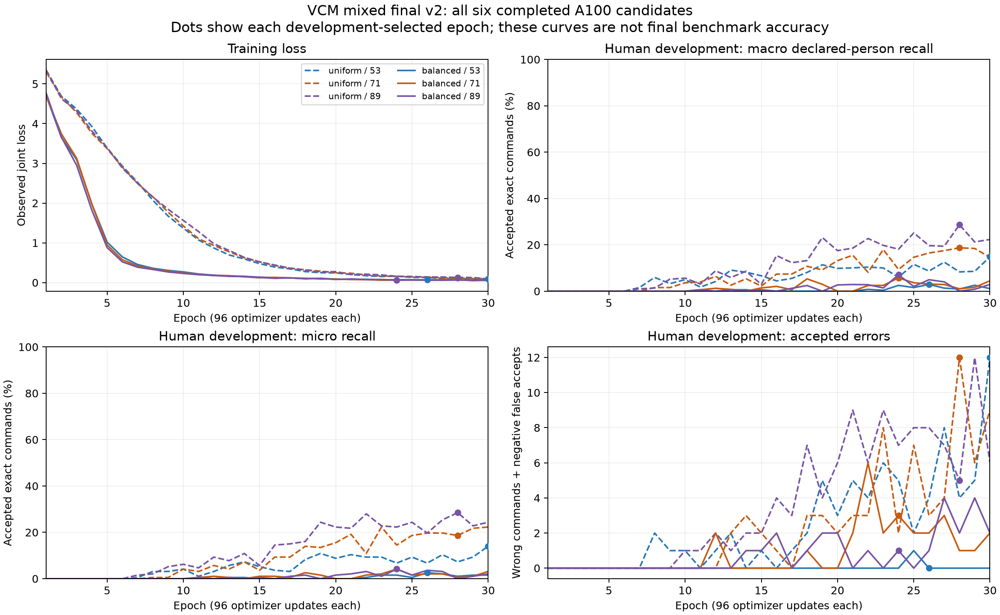

# Selected-candidate finalization notes

**Status: blocked / Pi-deferred.** The Pi ZIP is an experimental handoff of the measured candidate. Non-Pi accuracy qualification has failed or remains blocked.

The comprehensive report is [EXPERIMENT-vcm-mixed-final-v2.md](../docs/EXPERIMENT-vcm-mixed-final-v2.md). The [JSON card](card.json), [Markdown card](MODEL_CARD.md), [editable HTML](cards/MODEL_CARD.html), [PowerPoint](cards/MODEL_CARD.pptx), [PDF](cards/MODEL_CARD.pdf), and [complete missed-verbatim CSV](missed-verbatims.csv) preserve the actual selected-candidate results.

## Training and fixed candidate

All six uniform/balanced seed 53/71/89 arms completed 30 epochs and 2,880 updates each: 17,280 updates total on one A100. The actual losses and gradients were finite, every epoch changed parameters, and all 17 frozen fitting-source hashes remained unchanged. Human-development ranking selected uniform seed 89, epoch 28 before calibration or held evaluation. The immutable epoch-28 receipt records 2,688 cumulative updates for that checkpoint; the selection summary's 2,880-update field describes the completed 30-epoch arm. The ranking uses diagnostic proposals; it is separate from the later calibrated accepted-command accuracy.

The model has 280,818 parameters: 40-channel log-mel frontend, width-128 stem, eight depthwise temporal residual blocks, 16 whole-utterance semantic queries, and intent/role/validity/finite-value/entity heads. The source-bound complete architecture is in the comprehensive report. Grammar, catalog, typed outputs and 0.95 intent / 0.90 supplied-slot thresholds remain fixed.

Independent recomputation of normalization used all 3,791 training feature files and 1,057,193 frames, with zero mean/std difference. No development, calibration, enrollment, held or final-TTS frame was used. The exact selected checkpoint rebuilt 33 enrollment examples for 11 names. Calibration used a separate 1,247-row split. Contact acoustic-enrollment group /3 and timezone schema-constant group /1 have no calibration observations and retain rejection behavior.



## Human and original synthetic results

Exact accuracy means accepted, fully correct supported commands. Slot-bearing correctness requires every supplied typed slot, the correct intent and the exact expected field set. Each cohort is reported separately; overlapping historical trials are not pooled as fresh evidence. The two original-test capture faults were overlong ambiguous recordings and remain in their fault and ambiguous accounting.

| Cohort | Kind | Accounting | Exact correct / supported | Exact accuracy | All slots correct / slot-bearing | False accepts / negatives | Faults | Ambiguous |
| --- | --- | --- | --- | --- | --- | --- | --- | --- |
| fresh_human106 | human | fresh | 0/93 | 0.0000% | 0/82 | 0/13 | 0 | 0 |
| mandatory_defaults202 | human | regression | 2/86 | 2.3256% | 0/62 | 0/10 | 0 | 0 |
| mandatory_defaults202 | synthetic | regression | 3/100 | 3.0000% | 0/76 | 0/6 | 0 | 0 |
| original_holdout196 | human | regression | 5/83 | 6.0241% | 0/59 | 0/11 | 0 | 2 |
| original_holdout196 | synthetic | regression | 3/100 | 3.0000% | 0/76 | 0/0 | 0 | 0 |
| original_test4418 | human | regression | 25/636 | 3.9308% | 0/381 | 0/229 | 2 | 185 |
| original_test4418 | synthetic | regression | 19/3368 | 0.5641% | 0/2665 | 0/0 | 0 | 0 |

The fresh suite contains 106 recordings from 10 previously unused declared FSC identities: 93 supported and 13 negatives, covering six positive intents. Twelve positive intents have no fresh exact-reference recording; 224 unmatched available utterances were preserved without relabeling. Declared identity/file/decoded-PCM/recording-group separation passed. Physical cross-source aliases and TTS model ancestry do not have independent verification.

The unmodified pinned mandatory loader returned 202 clips, including its duplicate cases. Its README's historical 196 is not substituted for the actual current defaults. All original typed references are unchanged. Of these clips, 140 share PCM and reference with original-196; all mandatory results are regression. Publisher intent/93-command/conditional-slot scores are retained separately from strict exact-command and every-slot counts. This was CUDA command-audio replay; the official live laptop-speaker-to-Pi-microphone run remains deferred.

## What the model missed

Every failed command remains in [missed-verbatims.csv](missed-verbatims.csv) and the full source-row/prediction/miss JSONL in the portable evidence. For example, the fresh human verbatim `Turn on the lights` was rejected; the original synthetic verbatim `Send my message` was incorrectly accepted as `WEATHER` instead of `MESSAGE`. The latter is the one accepted wrong positive in original-test; it is separate from negative false accepts.

Observed miss reasons are descriptive results, not inferred causes:

| Cohort | Missed trials | Observed outcomes / rejection reasons |
| --- | --- | --- |
| fresh_human106 | 93 | {"OOV": 13, "intent_confidence": 72, "invalid_argument_or_slot_confidence": 8} |
| mandatory_defaults202 | 181 | {"OOV": 40, "extra_or_uncertain_role": 7, "intent_confidence": 129, "invalid_argument_or_slot_confidence": 5} |
| original_holdout196 | 175 | {"OOV": 39, "extra_or_uncertain_role": 7, "intent_confidence": 126, "invalid_argument_or_slot_confidence": 3} |
| original_test4418 | 3962 | {"OOV": 1277, "extra_or_uncertain_role": 70, "fault": 2, "intent_confidence": 2523, "invalid_argument_or_slot_confidence": 88, "request_validity": 1, "wrong_complete_command": 1} |

No post-test training, selection, calibration, enrollment, reference correction or threshold reduction was performed. The exporter path correction happened before held evaluation; it canonicalizes both paths without changing any model or bound input. The Pi-card correction changes only the derived status suffix after actual Pi evidence. A separate versioned receipt-path adapter corrects pure card verification after the tests while leaving the original frozen source files and neural receipts unchanged.

## Final TTS accounting and preserved failures

The complete pinned Hugging Face hexgrad/Kokoro-82M snapshot at f3ff3571791e39611d31c381e3a41a3af07b4987 was fetched. Actual synthesis used the separately pinned FP32 fastrtc/kokoro-onnx graph at 8d07950c9b6c87ce6809e9bba7bd494336217c2a; all 13 used voice arrays matched the primary voice packs with zero observed maximum absolute error. Both source revisions, hashes and licenses remain preserved.

Every preserved supported, negative and catalog form was attempted with af_heart, af_bella, af_nicole, am_fenrir, am_michael and am_puck at 0.9/1.0/1.1. There are 18,666 unique first takes and 26,010 case references (20,736 supported / 5,274 negative). Technical review rechecked 89,296 file hashes and reproduced all 2,017 generation faults: 1,938 native finite/amplitude/silence guard failures and 79 unchanged capture-contract failures. The native guard does not independently establish audible clipping. Native arrays/float WAVs, faults and all first takes remain preserved; no take was replaced or cherry-picked.

Independent listening was not completed because the available interface could not deliver audio for hearing. The [technical quarantine lock](final-TTS-technical-quarantine-lock.json) seals the evidence and explicitly forbids final scoring. It is not a qualified supplemental listening lock. No final-TTS recognition inference was run, so accuracy, every-slot correctness and recognition false accepts/faults remain unmeasured for every voice. The final set was never used for training, selection, calibration or enrollment.

| Voice | Attempted unique takes | Valid mono 16 kHz WAVs | Generation faults | Recognition accuracy |
| --- | --- | --- | --- | --- |
| af_bella | 3111 | 3108 | 3 | not measured |
| af_heart | 3111 | 3109 | 2 | not measured |
| af_nicole | 3111 | 3064 | 47 | not measured |
| am_fenrir | 3111 | 1933 | 1178 | not measured |
| am_michael | 3111 | 3098 | 13 | not measured |
| am_puck | 3111 | 2337 | 774 | not measured |

## Backend and service scope

Six fixed numerical probes passed PyTorch CUDA / ONNX CUDA parity (maximum error 3.814697265625e-6 at tolerance 2e-5). The raw node profile verified 141 CUDA nodes and zero CPU nodes. Full-waveform parity follows below; all these repeated trials count as regression and matching capture faults remain separate from compared valid decisions.

```json
{
  "parity_passed": true,
  "provider_placement": {
    "CPU_neural_inference_performed": false,
    "cpu_metadata_node_count": 0,
    "cuda_node_count": 141,
    "profiled_calls": 4920,
    "reason": null,
    "status": "verified_cuda_neural_placement"
  },
  "status": "passed_cuda_waveform_parity",
  "total": {
    "capture_faults": 2,
    "compared_valid": 4920,
    "decision_equal": 4920,
    "execution_faults": 0,
    "faults": 2,
    "final_decision_agreements": 4920,
    "first_pass_equal": 4920,
    "head_max_errors": {
      "entities": 2.682209014892578e-07,
      "intent": 1.1444091796875e-05,
      "role_states": 9.5367431640625e-06,
      "validity": 7.62939453125e-06,
      "values": 9.5367431640625e-06
    },
    "matching_capture_faults": 2,
    "missing": 0,
    "numeric_passes": 4920,
    "ort_calls": 4920,
    "parity_failures": 0,
    "parity_passed": true,
    "passed_valid": 4920,
    "preserved_first_pass_faults": 0,
    "preserved_first_pass_missing": 0,
    "scope": "CUDA numeric/final-decision agreement; no label accuracy is measured; matching capture faults are separate from compared decisions",
    "statuses": {
      "matching_capture_fault": 2,
      "passed": 4920
    },
    "trials": 4922,
    "valid_captures": 4920,
    "written_rows": 4922
  }
}
```

Selected ncnn conversion/parity and the real resident service were not run under the outstanding CPU-only inference hold. The Pi package preserves the existing ONNX Runtime CPU command-WAV service; it adds no Vulkan backend, affinity or memory cap. Launching this worker alone does not validate live microphone capture, wake, owner identity or the official physical benchmark. No paired owner recording receipt exists.

## Exact failed and blocked gates

| Gate | Status | Requirement |
| --- | --- | --- |
| final_tts_generation_qa | failed | Generation failures retained separately from recognition errors |
| final_tts_listening_and_lock | blocked | Independent pre-result listening and supplemental lock are incomplete |
| final_tts_replay | blocked | Final six-voice ncnn replay has not run; all recognition metrics remain unmeasured |
| fresh_human_scope | failed | Fresh human recordings must cover the complete intent contract |
| ncnn_parity | blocked | CPU-only inference hold remains unanswered; no selected ncnn replay receipt |
| owner_paired_recordings | blocked | No completed selected-candidate paired owner recording receipt |
| physical_person_alias_verification | blocked | Declared-source identity, recording-group and file/PCM separation is checked; physical cross-source alias equivalence remains unverified |
| resident_service | blocked | CPU-only inference hold remains unanswered; actual resident service is unmeasured |
| reviewed_acoustic_supervision | failed | Independent listening and reviewed acoustic spans are required |
| slot_calibration_coverage | failed | Missing cells retain rejection behavior |
| value_head_supervision | failed | Actual finite-value loss denominators must be nonzero |

## Evidence, provenance and cleanup

The semi-final evidence manifest maps original absolute source identities to portable content-addressed copies supplied in the ZIP. It contains unchanged run/epoch/loss/update/calibration/enrollment/export/first-pass/parity/TTS/source receipts and raw result files. The final human/raw TTS audio and training cache remain locally preserved.

The supplied package contains service-readiness.patch; no separate final-directory.patch was supplied. Final-directory source was recovered from the authenticated configured origin, and supplied package/readiness source was hash checked and reviewed. The normal project commits go through that origin; the unrelated local integration branch is preserved.

Superseded final README/card files and closed package-import/software-fixture residuals are archived with hashes and restoration mappings. Historical receipt reads retain compatibility symlinks. The original final/vcm-finalization-package.zip remains at SHA-256 1f11a6188cbaa27bb4199e7aca728a3a502a7d387c1306ac5c47283f1187e491: the preserved README requires actual accuracy gates to pass before its deletion, and those gates have not passed.

Physical Pi hardware, latency, RTF, RSS, CPU, wake, thermal and power fields remain deferred. After actual Pi measurements, the packaged deterministic updater writes derived results/card.json and results/MODEL_CARD.md from the frozen baseline and bound actual receipt. It preserves every non-Pi failure and cannot turn this blocked candidate into an accuracy-ready release.
